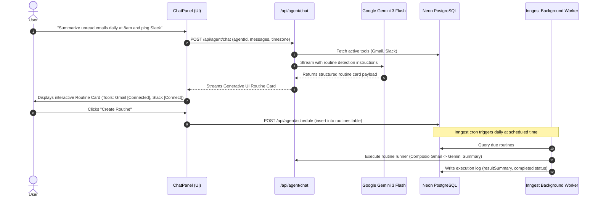

# Meow Bot (Orbit Groqbot Clone) — Complete Engineering & Chapter Blueprint

Based on **Tube Guruji's** complete video tutorial (*"Build a Full Stack AI Agent SaaS Platform with Cloud VM Desktop, Inngest, Composio & Next.js"*).

---

## 1. Master Chapter Breakdown & Status Matrix

| Chapter | Video Timestamp | Chapter Title | Core Components & Files | Status |
| :--- | :--- | :--- | :--- | :--- |
| **Ch. 1** | `0:00` | **Introduction & Demo** | Platform architecture, VM desktop, recurring routines, Composio toolkits | ✅ Completed |
| **Ch. 2** | `16:58` | **Project Setup** | Next.js 15, Tailwind CSS, Shadcn UI, Figtree font, Base-UI | ✅ Completed |
| **Ch. 3** | `30:23` | **AI Code Review** | CodeRabbit GitHub PR review integration | ✅ Completed |
| **Ch. 4** | `35:03` | **Setup Auth & DB** | NextAuth (Google OAuth), Drizzle ORM, Neon PostgreSQL (`users` table) | ✅ Completed |
| **Ch. 5** | `59:28` | **Workspace Layout** | Protected `/workspace`, dual-column UI, AppSidebar, DiceBear avatars | ✅ Completed |
| **Ch. 6** | `1:21:36` | **Create Agent** | `agent_config` schema, `POST/GET /api/agent`, Agent Creation Wizard, dynamic routes | ✅ Completed |
| **Ch. 7** | `1:50:36` | **Agent Chat & Config UI** | Modular chat panel, configuration hub, responsive layout | ✅ Completed |
| **Ch. 8** | `1:55:42` | **Agent Configuration** | `agent-config-context.tsx`, `PUT /api/agent`, avatar shuffle, settings persistence | ✅ Completed |
| **Ch. 9** | `2:23:11` | **Setup Agent SDK** | Google Gemini 3 Flash Preview, Vercel AI SDK v7, streaming chat (`/api/agent/chat`) | ✅ Completed |
| **Ch. 10** | `3:04:18` | **Setup Tools (Composio)** | `tools` table in DB, Composio v3 SDK, OAuth connection flow, Gmail integration live | ✅ Completed |
| **Ch. 11** | `3:27:08` | **Create Routine & Generative UI** | Structured agent response schema, Routine Card in chat, tool dependency check | 🟡 In Progress |
| **Ch. 12** | `4:04:02` | **Connect & Disconnect Account** | `/api/tools/connect`, `/api/tools/disconnect`, `/api/tools/status`, inline tool auth | ✅ Completed |
| **Ch. 13** | `4:14:24` | **Quick Fix (Save Tools)** | Saving connected tool status in `agent_config.tools` column | ✅ Completed |
| **Ch. 14** | `4:18:43` | **Create, Update & Delete Routine** | Save routine from chat card, edit routine prompt, delete routine with confirmation | 🟡 In Progress |
| **Ch. 15** | `4:35:21` | **Execute Routine via Inngest** | Inngest cron (`0 * * * *`), durable job execution, Gmail fetch, summary synthesis, logs | ✅ Completed |
| **Ch. 16** | `4:56:26` | **Save Chat History & Logs** | `agent_chat_history` table in Neon, persistent chat restoration across page reloads | ⏳ Next |
| **Ch. 17** | `5:06:53` | **VM Desktop Sandbox (E2B)** | `@e2b/desktop`, persistent sandbox per agent, live desktop preview & full-screen UI | ⏳ Upcoming |
| **Ch. 18** | `5:35:36` | **Tool Marketplace & Danger Zone**| Marketplace modal dialog (search/connect/disconnect), Pause Agent, Delete Agent | ⏳ Upcoming |
| **Ch. 19** | `5:38:27` | **Deploy App & Production Sync**| Vercel deployment, Inngest Cloud webhooks, NextAuth production URLs | ⏳ Upcoming |

---

## 2. Architectural Data Flow: Chat -> Routine Card -> Inngest -> Execution

---

## 3. Detailed Component & Schema Specifications

### A. Database Schemas (`db/schema.ts`)
1. **`users`**: User identity, email, complimentary credits.
2. **`agent_config`**: Agent ID, name, description, avatar, userEmail, attached tools.
3. **`tools`**: Available Composio catalog integrations (Slack, Gmail, Outlook, Notion, GitHub, Reddit).
4. **`routines`**: Scheduled cron automation tasks tied to agents (`routineId`, `agentId`, `prompt`, `frequency`, `scheduledTime`, `isActive`, `lastRunAt`).
5. **`execution_logs`**: Historical audit runs with status (`running`, `completed`, `failed`) and synthesized reports.
6. **`agent_chat_history`** *(Chapter 16)*: Chat conversation messages stored per agent so conversations persist across page refreshes.

### B. Generative UI: Chat Routine Card *(Chapters 11 & 14)*
When the agent detects intent to create a recurring workflow:
- Returns structured JSON or delimited markdown block containing:
  - `routine_name`: E.g., "Daily Unread Email Briefing"
  - `frequency`: `daily` | `weekly` | `monthly` | `once`
  - `scheduled_time`: E.g., "08:00 AM"
  - `required_tools`: `["gmail", "slack"]`
  - `instruction`: Exact prompt instructions for the background runner
- The Chat UI parses this into an interactive **Routine Card**:
  - Displays each required tool with its live connection badge.
  - If a tool is disconnected, provides a direct 1-click **"+ Connect"** button.
  - Once required tools are ready, the **"Create Routine"** button is enabled.
  - Clicking **"Create Routine"** calls `POST /api/agent/schedule` and adds it directly to the agent's active background jobs.

### C. Cloud VM Desktop Sandbox via E2B *(Chapter 17)*
- **Service:** E2B.dev desktop sandbox (`@e2b/desktop`).
- **State:** Persistent sandbox per agent stored in `agent_config.e2b_sandbox_id`.
- **UI:** 
  - Compact viewport in the right panel's **VM** tab.
  - Full-screen interactive modal overlay granting user access to browser, terminal, and file manager.
- **Behavior:** Auto-pause after 2 minutes of inactivity to preserve compute credits.
- **Tooling:** Agent can trigger browser actions (navigate, scroll, click, extract text) and return structured findings.

### D. Tool Marketplace & Danger Zone *(Chapter 18)*
- **Marketplace Modal:** Opens from the sidebar button; displays connected tools with disconnect buttons and catalog of available tools to connect.
- **Agent Settings:**
  - Pause/Deactivate Agent toggle.
  - Danger Zone: Delete Agent with double confirmation and cascading cleanup.

---

## 4. Current Status & Next Execution Steps
1. **Finish Chapter 11 & 14 UI Loop:**
   - Add structured routine detection to `app/api/agent/chat/route.ts`.
   - Render the interactive **Routine Card** in `components/custom/agent-space/chat-panel.tsx` with live tool dependency badges and 1-click "Create Routine".
2. **Implement Chapter 16:**
   - Add `agent_chat_history` table in `db/schema.ts`, push schema, and persist messages on send and load on mount.
3. **Implement Chapter 17:**
   - Setup E2B desktop sandbox client, add `e2b_sandbox_id` to schema, and build the VM Desktop Tab UI.
