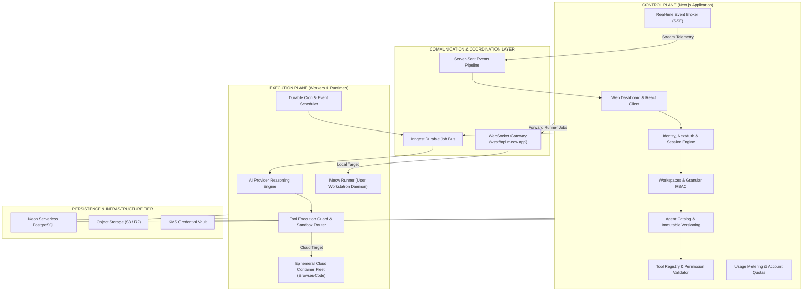
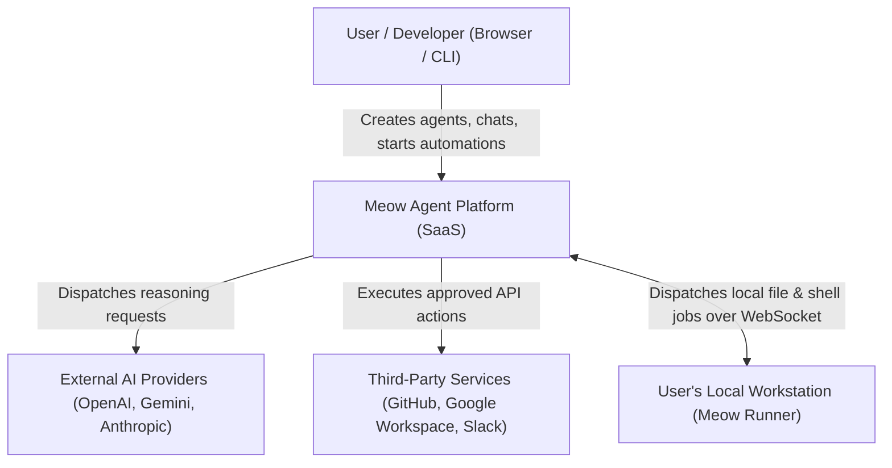
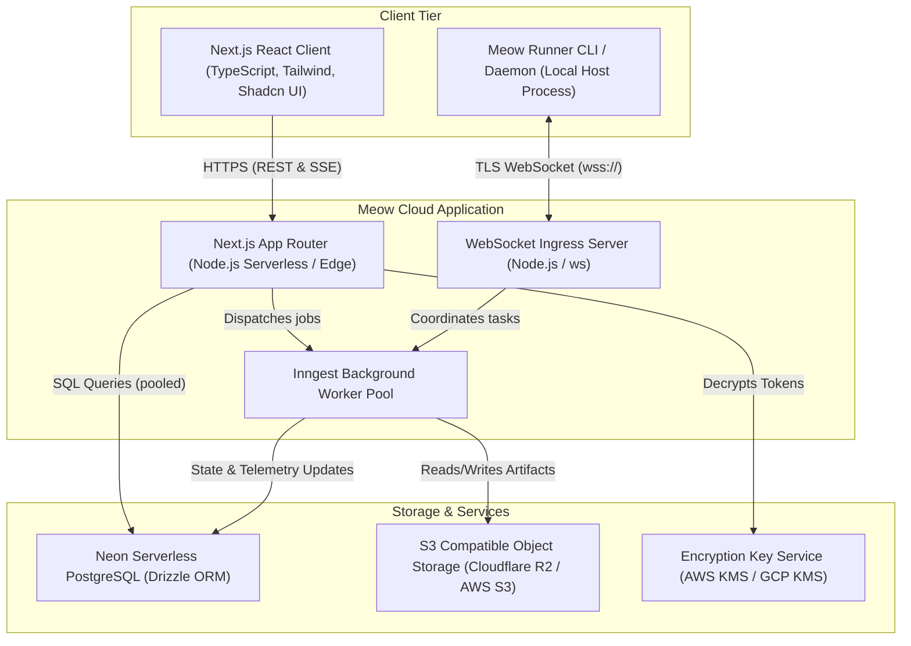
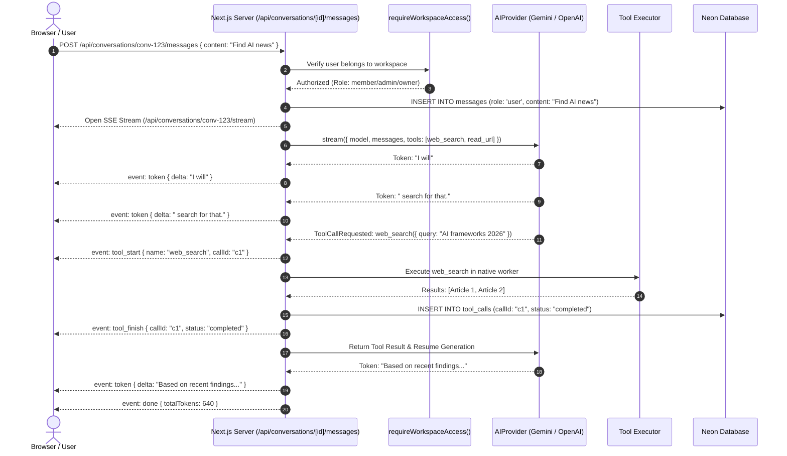
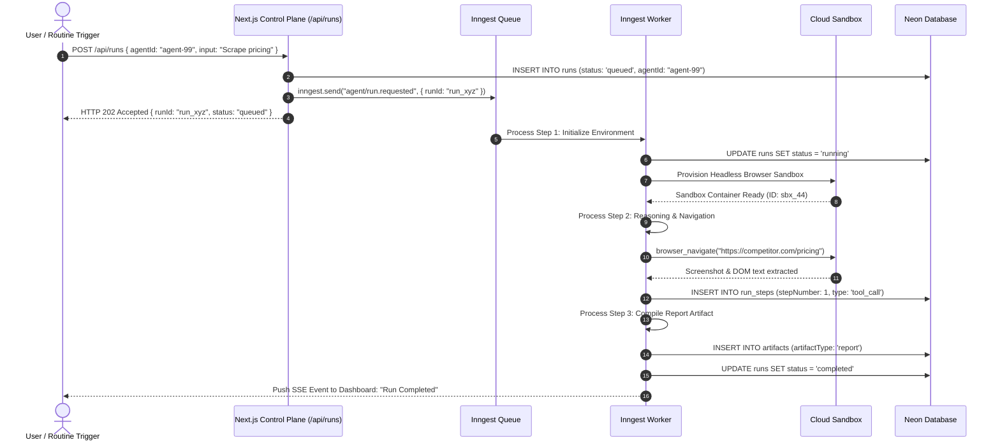
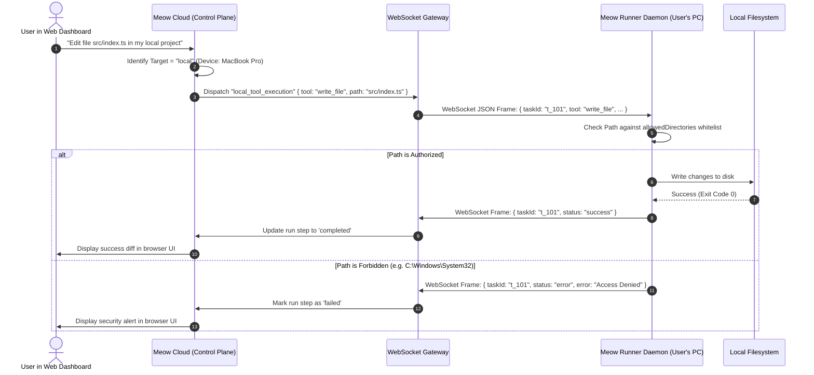

# 01 — System Architecture & Two-Plane Model

This document specifies the high-level system topology, the two-plane architectural separation, C4 architecture models, and request lifecycles for **Meow**.

---

## 1. The Core Architectural Division: Control Plane vs. Execution Plane

Meow is structured into two fundamental planes to guarantee reliability, responsiveness, and safety.

### Control Plane Responsibilities:
- **Tenant Isolation:** Enforces that every user request is verified against the workspace membership table.
- **Configuration Management:** Manages agent system instructions, hyperparameters, and connected credentials.
- **Fast HTTP Responses:** Never blocks on long-running LLM inferences, browser automation, or code execution.
- **Audit Logging:** Records administrative actions and approval events.

### Execution Plane Responsibilities:
- **Non-blocking Durable Execution:** Handles multi-minute tasks, retries, and step-level execution via Inngest.
- **Model Invocations:** Orchestrates streaming calls to OpenAI, Google Gemini, Anthropic, or local models.
- **Tool Execution:** Executes tool actions either in isolated cloud containers (Docker/gVisor) or on user workstations via the Meow Runner.
- **Enforcing Sandboxes:** Confines agent file operations and code execution strictly to allowed directories.

---

## 2. C4 Architecture Models

### Level 1: System Context Diagram

---

### Level 2: Container Diagram

---

## 3. End-to-End Request Lifecycles

### Flow A: Interactive Chat with Tool Calling (Synchronous + SSE Streaming)

---

### Flow B: Autonomous Long-Running Task (Asynchronous Inngest Workflow)

---

### Flow C: Local Workstation Execution (Meow Runner)

