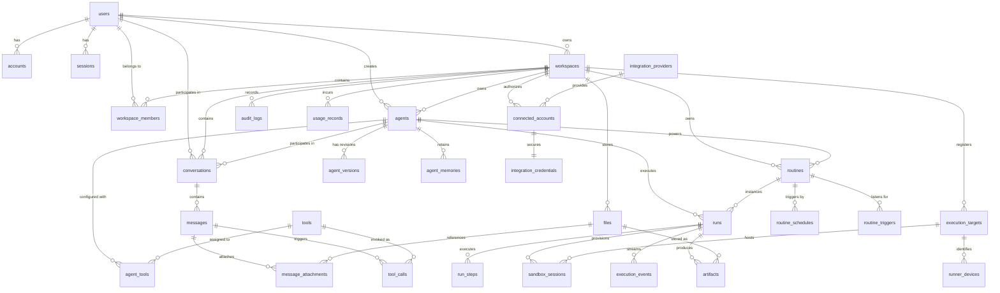

# 02 — Database Architecture, Schemas & Data Model

This document specifies the complete relational data model for **Meow**, covering all 8 domains with exact Drizzle ORM TypeScript definitions, data dictionaries, constraints, and migration strategies.

---

## 1. Master Entity-Relationship Diagram



---

## 2. Drizzle ORM TypeScript Schema Implementation

The following TypeScript definitions represent the target evolution of [`db/schema.ts`](file:///c:/Users/manis/meow/db/schema.ts).

### Domain 1: Identity & Tenancy (Phase 1 & 2 Active)

```typescript
import { sql } from "drizzle-orm";
import {
  check,
  index,
  integer,
  jsonb,
  numeric,
  pgTable,
  primaryKey,
  serial,
  text,
  timestamp,
  uniqueIndex,
  boolean,
} from "drizzle-orm/pg-core";
import type { AdapterAccount } from "next-auth/adapters";

export type WorkspaceRole = "owner" | "admin" | "member";

// --- Users ---
export const users = pgTable("users", {
  id: text("id").primaryKey().default(sql`gen_random_uuid()::text`),
  name: text("name"),
  email: text("email").notNull().unique(),
  emailVerified: timestamp("email_verified", { mode: "date" }),
  image: text("image"),
  createdAt: timestamp("created_at", { mode: "date" }).defaultNow().notNull(),
});

// --- Accounts (OAuth) ---
export const accounts = pgTable(
  "accounts",
  {
    userId: text("user_id")
      .notNull()
      .references(() => users.id, { onDelete: "cascade" }),
    type: text("type").$type<AdapterAccount["type"]>().notNull(),
    provider: text("provider").notNull(),
    providerAccountId: text("provider_account_id").notNull(),
    refresh_token: text("refresh_token"),
    access_token: text("access_token"),
    expires_at: integer("expires_at"),
    token_type: text("token_type"),
    scope: text("scope"),
    id_token: text("id_token"),
    session_state: text("session_state"),
  },
  (table) => ({
    providerAccountPk: primaryKey({ columns: [table.provider, table.providerAccountId] }),
    userIdIndex: index("accounts_user_id_idx").on(table.userId),
  }),
);

// --- Sessions ---
export const sessions = pgTable("sessions", {
  sessionToken: text("session_token").primaryKey(),
  userId: text("user_id")
    .notNull()
    .references(() => users.id, { onDelete: "cascade" }),
  expires: timestamp("expires", { mode: "date" }).notNull(),
});

// --- Verification Tokens ---
export const verificationTokens = pgTable(
  "verification_tokens",
  {
    identifier: text("identifier").notNull(),
    token: text("token").notNull(),
    expires: timestamp("expires", { mode: "date" }).notNull(),
  },
  (table) => ({
    tokenPk: primaryKey({ columns: [table.identifier, table.token] }),
  }),
);

// --- Workspaces ---
export const workspaces = pgTable(
  "workspaces",
  {
    id: text("id").primaryKey().default(sql`gen_random_uuid()::text`),
    name: text("name").notNull(),
    slug: text("slug").notNull().unique(),
    ownerUserId: text("owner_user_id")
      .notNull()
      .references(() => users.id, { onDelete: "restrict" }),
    createdAt: timestamp("created_at", { mode: "date" }).defaultNow().notNull(),
    updatedAt: timestamp("updated_at", { mode: "date" }).defaultNow().notNull(),
  },
  (table) => ({
    ownerUserIdIndex: index("workspaces_owner_user_id_idx").on(table.ownerUserId),
  }),
);

// --- Workspace Membership ---
export const workspaceMembers = pgTable(
  "workspace_members",
  {
    workspaceId: text("workspace_id")
      .notNull()
      .references(() => workspaces.id, { onDelete: "cascade" }),
    userId: text("user_id")
      .notNull()
      .references(() => users.id, { onDelete: "cascade" }),
    role: text("role").$type<WorkspaceRole>().notNull().default("member"),
    joinedAt: timestamp("joined_at", { mode: "date" }).defaultNow().notNull(),
  },
  (table) => ({
    memberPk: primaryKey({ columns: [table.workspaceId, table.userId] }),
    roleCheck: check(
      "workspace_members_role_check",
      sql`${table.role} in ('owner', 'admin', 'member')`,
    ),
    userIdIndex: index("workspace_members_user_id_idx").on(table.userId),
  }),
);
```

---

### Domain 2: Agent Ecosystem (Phase 2 Active + Phase 4 Extension)

```typescript
export type AgentStatus = "active" | "archived";

// --- Agents ---
export const agents = pgTable(
  "agents",
  {
    id: text("id").primaryKey().default(sql`gen_random_uuid()::text`),
    workspaceId: text("workspace_id")
      .notNull()
      .references(() => workspaces.id, { onDelete: "cascade" }),
    name: text("name").notNull(),
    description: text("description"),
    status: text("status").$type<AgentStatus>().notNull().default("active"),
    createdBy: text("created_by")
      .notNull()
      .references(() => users.id, { onDelete: "restrict" }),
    createdAt: timestamp("created_at", { mode: "date" }).defaultNow().notNull(),
    updatedAt: timestamp("updated_at", { mode: "date" }).defaultNow().notNull(),
  },
  (table) => ({
    workspaceIndex: index("agents_workspace_id_idx").on(table.workspaceId),
    statusCheck: check("agents_status_check", sql`${table.status} in ('active', 'archived')`),
  }),
);

// --- Agent Versions (Immutable) ---
export const agentVersions = pgTable(
  "agent_versions",
  {
    id: text("id").primaryKey().default(sql`gen_random_uuid()::text`),
    agentId: text("agent_id")
      .notNull()
      .references(() => agents.id, { onDelete: "cascade" }),
    version: integer("version").notNull(),
    instructions: text("instructions").notNull(),
    model: text("model").notNull(),
    config: jsonb("config").$type<Record<string, unknown>>().notNull().default(sql`'{}'::jsonb`),
    createdBy: text("created_by")
      .notNull()
      .references(() => users.id, { onDelete: "restrict" }),
    createdAt: timestamp("created_at", { mode: "date" }).defaultNow().notNull(),
  },
  (table) => ({
    agentVersionUnique: uniqueIndex("agent_versions_agent_version_unique").on(table.agentId, table.version),
    agentIndex: index("agent_versions_agent_id_idx").on(table.agentId),
    versionCheck: check("agent_versions_version_check", sql`${table.version} > 0`),
  }),
);

// --- Agent Tools Association ---
export const agentTools = pgTable(
  "agent_tools",
  {
    id: text("id").primaryKey().default(sql`gen_random_uuid()::text`),
    agentId: text("agent_id")
      .notNull()
      .references(() => agents.id, { onDelete: "cascade" }),
    toolId: text("tool_id")
      .notNull()
      .references(() => tools.id, { onDelete: "cascade" }),
    enabled: boolean("enabled").notNull().default(true),
    configOverride: jsonb("config_override").notNull().default(sql`'{}'::jsonb`),
    createdAt: timestamp("created_at", { mode: "date" }).defaultNow().notNull(),
  },
  (table) => ({
    agentToolUnique: uniqueIndex("agent_tools_agent_tool_unique").on(table.agentId, table.toolId),
  }),
);

// --- Agent Memories ---
export const agentMemories = pgTable(
  "agent_memories",
  {
    id: text("id").primaryKey().default(sql`gen_random_uuid()::text`),
    agentId: text("agent_id")
      .notNull()
      .references(() => agents.id, { onDelete: "cascade" }),
    memoryType: text("memory_type").notNull(), // 'fact', 'preference', 'instruction'
    content: text("content").notNull(),
    metadata: jsonb("metadata").notNull().default(sql`'{}'::jsonb`),
    createdAt: timestamp("created_at", { mode: "date" }).defaultNow().notNull(),
  },
  (table) => ({
    agentIndex: index("agent_memories_agent_id_idx").on(table.agentId),
  }),
);
```

---

### Domain 3: Conversations & Messages (Phase 3 Target)

```typescript
// --- Conversations ---
export const conversations = pgTable(
  "conversations",
  {
    id: text("id").primaryKey().default(sql`gen_random_uuid()::text`),
    workspaceId: text("workspace_id")
      .notNull()
      .references(() => workspaces.id, { onDelete: "cascade" }),
    agentId: text("agent_id")
      .notNull()
      .references(() => agents.id, { onDelete: "cascade" }),
    agentVersionId: text("agent_version_id")
      .notNull()
      .references(() => agentVersions.id, { onDelete: "restrict" }),
    title: text("title").notNull().default("New Conversation"),
    createdBy: text("created_by")
      .notNull()
      .references(() => users.id, { onDelete: "restrict" }),
    createdAt: timestamp("created_at", { mode: "date" }).defaultNow().notNull(),
    updatedAt: timestamp("updated_at", { mode: "date" }).defaultNow().notNull(),
  },
  (table) => ({
    workspaceIdx: index("conversations_workspace_id_idx").on(table.workspaceId),
    agentIdx: index("conversations_agent_id_idx").on(table.agentId),
  }),
);

// --- Messages ---
export const messages = pgTable(
  "messages",
  {
    id: text("id").primaryKey().default(sql`gen_random_uuid()::text`),
    conversationId: text("conversation_id")
      .notNull()
      .references(() => conversations.id, { onDelete: "cascade" }),
    role: text("role").notNull(), // 'user' | 'assistant' | 'system' | 'tool'
    content: text("content").notNull(),
    metadata: jsonb("metadata").notNull().default(sql`'{}'::jsonb`),
    createdAt: timestamp("created_at", { mode: "date" }).defaultNow().notNull(),
  },
  (table) => ({
    conversationIdx: index("messages_conversation_id_idx").on(table.conversationId),
  }),
);

// --- Tool Calls ---
export const toolCalls = pgTable(
  "tool_calls",
  {
    id: text("id").primaryKey().default(sql`gen_random_uuid()::text`),
    messageId: text("message_id")
      .notNull()
      .references(() => messages.id, { onDelete: "cascade" }),
    toolId: text("tool_id")
      .notNull()
      .references(() => tools.id, { onDelete: "restrict" }),
    callId: text("call_id").notNull(),
    arguments: jsonb("arguments").notNull(),
    result: jsonb("result"),
    status: text("status").notNull(), // 'requested', 'executing', 'completed', 'failed'
    errorMessage: text("error_message"),
    durationMs: integer("duration_ms"),
    createdAt: timestamp("created_at", { mode: "date" }).defaultNow().notNull(),
  },
  (table) => ({
    messageIdx: index("tool_calls_message_id_idx").on(table.messageId),
  }),
);
```

---

### Domain 4: Tools & Third-Party Integrations

```typescript
// --- Tools Catalog ---
export const tools = pgTable("tools", {
  id: text("id").primaryKey(), // 'web_search', 'send_email', 'read_file'
  name: text("name").notNull(),
  description: text("description").notNull(),
  inputSchema: jsonb("input_schema").notNull(),
  executionType: text("execution_type").notNull(), // 'native', 'integration', 'sandbox'
  permissionLevel: text("permission_level").notNull(), // 'read', 'write', 'dangerous'
  requiresApproval: boolean("requires_approval").notNull().default(false),
  createdAt: timestamp("created_at", { mode: "date" }).defaultNow().notNull(),
});

// --- Integration Providers ---
export const integrationProviders = pgTable("integration_providers", {
  id: text("id").primaryKey(), // 'google', 'github', 'slack'
  name: text("name").notNull(),
  authType: text("auth_type").notNull(), // 'oauth2', 'api_key'
  scopes: text("scopes").array().notNull(),
  createdAt: timestamp("created_at", { mode: "date" }).defaultNow().notNull(),
});

// --- Connected Accounts ---
export const connectedAccounts = pgTable(
  "connected_accounts",
  {
    id: text("id").primaryKey().default(sql`gen_random_uuid()::text`),
    workspaceId: text("workspace_id")
      .notNull()
      .references(() => workspaces.id, { onDelete: "cascade" }),
    providerId: text("provider_id")
      .notNull()
      .references(() => integrationProviders.id, { onDelete: "restrict" }),
    accountIdentifier: text("account_identifier").notNull(),
    connectedBy: text("connected_by")
      .notNull()
      .references(() => users.id, { onDelete: "restrict" }),
    createdAt: timestamp("created_at", { mode: "date" }).defaultNow().notNull(),
    updatedAt: timestamp("updated_at", { mode: "date" }).defaultNow().notNull(),
  },
  (table) => ({
    accountUnique: uniqueIndex("connected_accounts_unique").on(
      table.workspaceId,
      table.providerId,
      table.accountIdentifier,
    ),
  }),
);

// --- Integration Credentials (KMS Encrypted) ---
export const integrationCredentials = pgTable("integration_credentials", {
  connectedAccountId: text("connected_account_id")
    .primaryKey()
    .references(() => connectedAccounts.id, { onDelete: "cascade" }),
  encryptedData: text("encrypted_data").notNull(), // AES-256-GCM ciphertext
  keyId: text("key_id").notNull(),
  expiresAt: timestamp("expires_at", { mode: "date" }),
  updatedAt: timestamp("updated_at", { mode: "date" }).defaultNow().notNull(),
});
```

---

### Domain 5: Automations, Routines & Autonomous Runs

```typescript
// --- Routines ---
export const routines = pgTable(
  "routines",
  {
    id: text("id").primaryKey().default(sql`gen_random_uuid()::text`),
    workspaceId: text("workspace_id")
      .notNull()
      .references(() => workspaces.id, { onDelete: "cascade" }),
    agentId: text("agent_id")
      .notNull()
      .references(() => agents.id, { onDelete: "cascade" }),
    name: text("name").notNull(),
    description: text("description"),
    status: text("status").notNull().default("active"),
    createdBy: text("created_by")
      .notNull()
      .references(() => users.id, { onDelete: "restrict" }),
    createdAt: timestamp("created_at", { mode: "date" }).defaultNow().notNull(),
    updatedAt: timestamp("updated_at", { mode: "date" }).defaultNow().notNull(),
  },
  (table) => ({
    workspaceIdx: index("routines_workspace_id_idx").on(table.workspaceId),
  }),
);

// --- Routine Schedules ---
export const routineSchedules = pgTable("routine_schedules", {
  routineId: text("routine_id")
    .primaryKey()
    .references(() => routines.id, { onDelete: "cascade" }),
  cronExpression: text("cron_expression").notNull(),
  timezone: text("timezone").notNull().default("UTC"),
  nextRunAt: timestamp("next_run_at", { mode: "date" }),
});

// --- Runs (Execution Instances) ---
export const runs = pgTable(
  "runs",
  {
    id: text("id").primaryKey().default(sql`gen_random_uuid()::text`),
    workspaceId: text("workspace_id")
      .notNull()
      .references(() => workspaces.id, { onDelete: "cascade" }),
    routineId: text("routine_id").references(() => routines.id, { onDelete: "set null" }),
    agentId: text("agent_id")
      .notNull()
      .references(() => agents.id, { onDelete: "restrict" }),
    agentVersionId: text("agent_version_id")
      .notNull()
      .references(() => agentVersions.id, { onDelete: "restrict" }),
    triggerSource: text("trigger_source").notNull(), // 'chat', 'schedule', 'webhook', 'manual'
    status: text("status").notNull().default("queued"), // 'queued', 'running', 'completed', 'failed'
    idempotencyKey: text("idempotency_key").unique(),
    startedAt: timestamp("started_at", { mode: "date" }),
    completedAt: timestamp("completed_at", { mode: "date" }),
    createdAt: timestamp("created_at", { mode: "date" }).defaultNow().notNull(),
  },
  (table) => ({
    workspaceIdx: index("runs_workspace_id_idx").on(table.workspaceId),
    statusIdx: index("runs_status_idx").on(table.status),
  }),
);

// --- Run Steps ---
export const runSteps = pgTable(
  "run_steps",
  {
    id: text("id").primaryKey().default(sql`gen_random_uuid()::text`),
    runId: text("run_id")
      .notNull()
      .references(() => runs.id, { onDelete: "cascade" }),
    stepNumber: integer("step_number").notNull(),
    stepType: text("step_type").notNull(), // 'thought', 'tool_call', 'final_answer'
    input: jsonb("input").notNull(),
    output: jsonb("output"),
    status: text("status").notNull(),
    durationMs: integer("duration_ms"),
    createdAt: timestamp("created_at", { mode: "date" }).defaultNow().notNull(),
  },
  (table) => ({
    stepUnique: uniqueIndex("run_steps_unique").on(table.runId, table.stepNumber),
  }),
);
```

---

### Domain 6, 7 & 8: Infrastructure, Files & Observability

```typescript
// --- Execution Targets ---
export const executionTargets = pgTable("execution_targets", {
  id: text("id").primaryKey().default(sql`gen_random_uuid()::text`),
  workspaceId: text("workspace_id")
    .notNull()
    .references(() => workspaces.id, { onDelete: "cascade" }),
  targetType: text("target_type").notNull(), // 'cloud', 'local'
  name: text("name").notNull(),
  status: text("status").notNull(), // 'online', 'offline', 'busy'
  lastHeartbeatAt: timestamp("last_heartbeat_at", { mode: "date" }),
});

// --- Runner Devices (Meow Runner) ---
export const runnerDevices = pgTable("runner_devices", {
  id: text("id").primaryKey().default(sql`gen_random_uuid()::text`),
  executionTargetId: text("execution_target_id")
    .notNull()
    .references(() => executionTargets.id, { onDelete: "cascade" }),
  deviceName: text("device_name").notNull(),
  platform: text("platform").notNull(),
  allowedPaths: text("allowed_paths").array().notNull(),
  tokenHash: text("token_hash").notNull(),
});

// --- Files ---
export const files = pgTable("files", {
  id: text("id").primaryKey().default(sql`gen_random_uuid()::text`),
  workspaceId: text("workspace_id")
    .notNull()
    .references(() => workspaces.id, { onDelete: "cascade" }),
  storageKey: text("storage_key").notNull().unique(),
  originalFilename: text("original_filename").notNull(),
  mimeType: text("mime_type").notNull(),
  sizeBytes: integer("size_bytes").notNull(),
  uploadedBy: text("uploaded_by")
    .notNull()
    .references(() => users.id, { onDelete: "restrict" }),
  createdAt: timestamp("created_at", { mode: "date" }).defaultNow().notNull(),
});

// --- Artifacts ---
export const artifacts = pgTable("artifacts", {
  id: text("id").primaryKey().default(sql`gen_random_uuid()::text`),
  runId: text("run_id")
    .notNull()
    .references(() => runs.id, { onDelete: "cascade" }),
  fileId: text("file_id")
    .notNull()
    .references(() => files.id, { onDelete: "cascade" }),
  artifactType: text("artifact_type").notNull(), // 'report', 'code', 'log'
  metadata: jsonb("metadata").notNull().default(sql`'{}'::jsonb`),
  createdAt: timestamp("created_at", { mode: "date" }).defaultNow().notNull(),
});

// --- Audit Logs ---
export const auditLogs = pgTable(
  "audit_logs",
  {
    id: text("id").primaryKey().default(sql`gen_random_uuid()::text`),
    workspaceId: text("workspace_id")
      .notNull()
      .references(() => workspaces.id, { onDelete: "cascade" }),
    actorUserId: text("actor_user_id")
      .notNull()
      .references(() => users.id, { onDelete: "restrict" }),
    action: text("action").notNull(),
    resourceType: text("resource_type").notNull(),
    resourceId: text("resource_id").notNull(),
    details: jsonb("details").notNull().default(sql`'{}'::jsonb`),
    ipAddress: text("ip_address"),
    createdAt: timestamp("created_at", { mode: "date" }).defaultNow().notNull(),
  },
  (table) => ({
    workspaceIdx: index("audit_logs_workspace_id_idx").on(table.workspaceId),
  }),
);

// --- Usage Records ---
export const usageRecords = pgTable(
  "usage_records",
  {
    id: text("id").primaryKey().default(sql`gen_random_uuid()::text`),
    workspaceId: text("workspace_id")
      .notNull()
      .references(() => workspaces.id, { onDelete: "cascade" }),
    runId: text("run_id").references(() => runs.id, { onDelete: "set null" }),
    model: text("model").notNull(),
    promptTokens: integer("prompt_tokens").notNull(),
    completionTokens: integer("completion_tokens").notNull(),
    totalTokens: integer("total_tokens").notNull(),
    estimatedCostUsd: numeric("estimated_cost_usd", { precision: 10, scale: 6 }).notNull(),
    createdAt: timestamp("created_at", { mode: "date" }).defaultNow().notNull(),
  },
  (table) => ({
    workspaceIdx: index("usage_records_workspace_id_idx").on(table.workspaceId),
  }),
);
```

---

## 3. Data Dictionary: Field Invariants & Nullability

| Table | Column | Type | Nullable | Constraints / Default | Purpose |
|---|---|---|:---:|---|---|
| `users` | `id` | `text` | No | PK, `gen_random_uuid()` | Global subject ID. |
| `users` | `email` | `text` | No | `UNIQUE` | One identity per verified email. |
| `workspaces` | `slug` | `text` | No | `UNIQUE` | URL-safe tenancy identifier. |
| `workspaces` | `owner_user_id` | `text` | No | FK -> `users.id` (RESTRICT) | Absolute tenancy owner. |
| `workspace_members` | `(workspace_id, user_id)` | `text` | No | Composite PK | User can only join a workspace once. |
| `workspace_members` | `role` | `text` | No | CHECK (`owner`, `admin`, `member`) | RBAC tier. |
| `agents` | `status` | `text` | No | CHECK (`active`, `archived`) | Soft deletion state. |
| `agent_versions` | `version` | `integer` | No | CHECK (`version > 0`) | Monotonically increasing revision. |
| `agent_versions` | `(agent_id, version)` | `text, int` | No | `UNIQUE INDEX` | Prevents version collision. |
| `tool_calls` | `arguments` | `jsonb` | No | JSON | Raw validated parameters passed to tool. |
| `integration_credentials` | `encrypted_data`| `text` | No | AES-256-GCM | Encrypted token; never plain text. |
| `runs` | `idempotency_key` | `text` | Yes | `UNIQUE` | Prevents duplicate run executions. |

---

## 4. Query Performance & Indexing Strategy

1. **Tenant Filtering (`workspace_id` Indexes):**
   Every tenant-scoped table (`agents`, `conversations`, `routines`, `runs`, `files`, `audit_logs`) has a dedicated B-tree index on `workspace_id`. This prevents costly sequential scans across thousands of workspaces.
2. **Composite Indexes for Membership Lookups:**
   `workspace_members` uses its composite PK `(workspace_id, user_id)` for sub-millisecond RBAC resolution on every API request.
3. **Immutable Ordering Indexes:**
   `agent_versions` indexes `agent_id`, enabling fast `ORDER BY version DESC LIMIT 1` queries when resolving an agent's latest active prompt.

