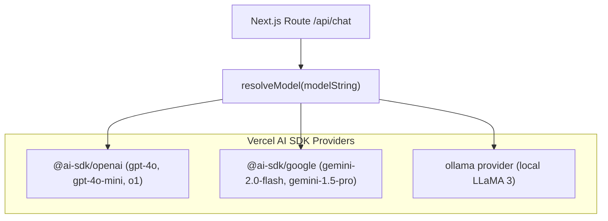
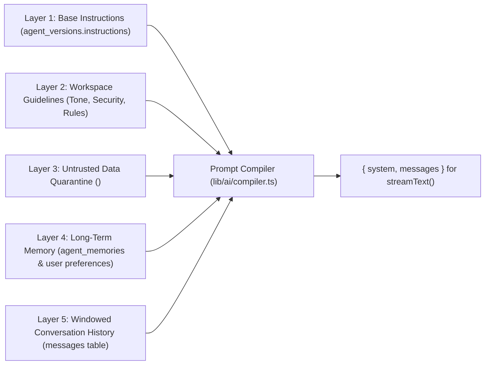

# 03 — Agent Runtime & Reasoning Engine (Vercel AI SDK Architecture)

The Agent Runtime is the cognitive kernel of Meow. In accordance with modern Next.js AI platform standards, Meow utilizes the **Vercel AI SDK (`ai`)** ecosystem (`@ai-sdk/openai`, `@ai-sdk/google`, `@ai-sdk/react`) for universal model provider resolution, type-safe Zod tool execution, and real-time streaming.

---

## 1. Provider & Model Resolution Architecture

Meow leverages Vercel AI SDK's provider abstraction to route agent requests seamlessly to OpenAI, Google Gemini, Anthropic, or local Ollama instances based on `agent_versions.model`.



### Model Resolver Implementation (`lib/ai/models.ts`)
```typescript
import { openai } from "@ai-sdk/openai";
import { google } from "@ai-sdk/google";
import { LanguageModelV1 } from "ai";

export function resolveModel(modelName: string): LanguageModelV1 {
  const normalized = modelName.trim().toLowerCase();

  if (normalized.startsWith("gemini-")) {
    return google(normalized);
  }

  if (
    normalized.startsWith("gpt-") ||
    normalized.startsWith("o1-") ||
    normalized.startsWith("o3-")
  ) {
    return openai(normalized);
  }

  // Fallback to OpenAI compatible endpoint for custom/local models
  return openai(normalized);
}
```

---

## 2. Dynamic Prompt Compilation Pipeline

Prompts are synthesized from 5 independent layers into a unified system prompt and message history passed to `streamText`:



---

## 3. Autonomous Multi-Step Tool Execution Loop (ReAct)

Vercel AI SDK provides native autonomous multi-step reasoning via `maxSteps`:

```typescript
import { streamText, tool } from "ai";
import { z } from "zod";

const result = streamText({
  model: resolveModel(agentVersion.model),
  system: compiledPrompt.system,
  messages: compiledPrompt.messages,
  tools: activeTools,
  maxSteps: 10, // ReAct autonomous tool-calling loop
  async onFinish({ text, toolCalls, toolResults, usage }) {
    // Persist assistant message, tool calls, and token usage into PostgreSQL
    await saveMessageTurn({ ... });
  },
});

return result.toDataStreamResponse();
```

---

## 4. Full-Stack Data & Streaming Flow

```
┌─────────────────────────────────────────────────────────────┐
│             FRONTEND: React Chat UI (@ai-sdk/react)         │
│  • useChat() hook connects to /api/chat                     │
│  • Renders streaming text, tool execution badges, & history  │
└──────────────────────────────▲──────────────────────────────┘
                               │ SSE Data Stream (toDataStreamResponse)
┌──────────────────────────────▼──────────────────────────────┐
│           BACKEND: Next.js Route (app/api/chat/route.ts)    │
│  1. Authenticates session & workspace RBAC                  │
│  2. Loads agent version & conversation from PostgreSQL      │
│  3. Compiles 5-layer prompt                                 │
│  4. Executes streamText() with maxSteps & Zod tools         │
│  5. Commits user & assistant turns to database in onFinish   │
└──────────────────────────────┬──────────────────────────────┘
                               │
                               ▼
┌─────────────────────────────────────────────────────────────┐
│          POSTGRESQL DATABASE (Drizzle ORM)                  │
│  • conversations table: Threads linked to agent versions     │
│  • messages table: User, assistant & tool message turns     │
│  • tool_calls table: Recorded actions & results              │
└─────────────────────────────────────────────────────────────┘
```
