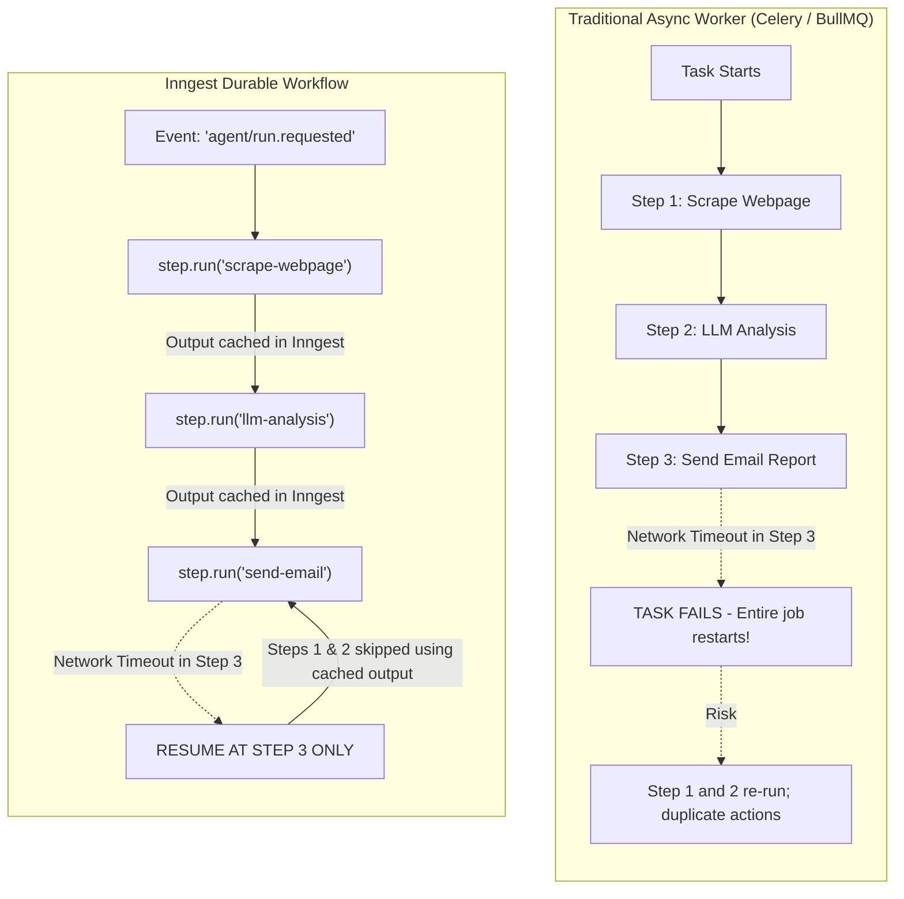
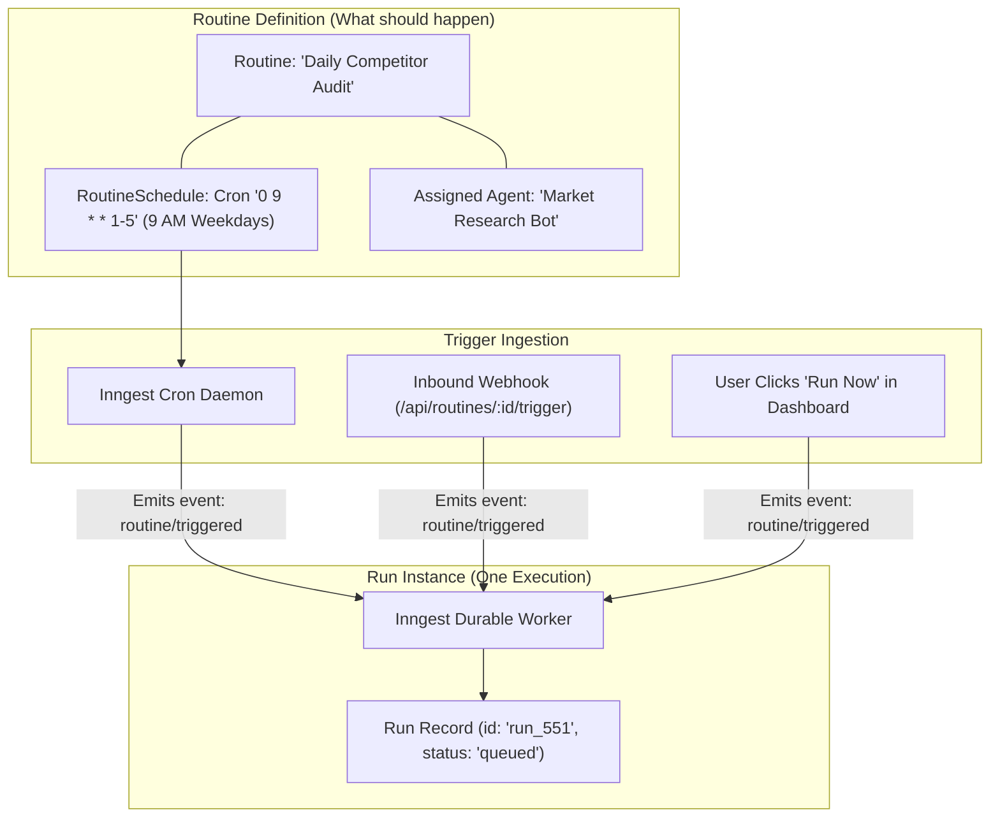

# 05 — Automation, Routines & Inngest Workflows

Autonomous agents execute multi-step plans that can run from tens of seconds to several minutes. Standard Next.js serverless functions have hard execution timeouts (e.g. 15–60 seconds on standard hosting) and are killed when connection drops occur.

Meow uses **Inngest** as its durable workflow orchestration backbone.

---

## 1. Durable Execution vs. Standard Asynchronous Handlers



### Core Inngest Benefits:
1. **Step-Level Memoization:** Each `step.run()` caches its return value in Inngest's durable storage. If step 4 crashes, the worker restarts immediately at step 4 without re-calling expensive LLM steps 1–3.
2. **Serverless Pause & Sleep:** An agent can execute `step.sleep("wait-for-email", "10m")` or wait for a user approval event (`step.waitForEvent`) without consuming CPU or memory while waiting.
3. **Automatic Concurrency Limits:** Workspaces can be throttled (e.g., maximum 5 concurrent active agent runs per workspace) to prevent database overload and runaway LLM costs.

---

## 2. Inngest Function Implementation

### The Core Autonomous Run Workflow

```typescript
import { inngest } from "@/lib/queue/inngest-client";
import { db } from "@/db";
import { runs, runSteps, agents, agentVersions } from "@/db/schema";
import { executeAgentLoopStep } from "@/modules/execution/runner";

export const executeAutonomousRun = inngest.createFunction(
  {
    id: "execute-autonomous-run",
    name: "Execute Autonomous Agent Run",
    concurrency: {
      limit: 5,
      key: "event.data.workspaceId", // Tenant-level concurrency control
    },
    retries: 3,
  },
  { event: "agent/run.requested" },
  async ({ event, step }) => {
    const { runId, workspaceId, agentId } = event.data;

    // Step 1: Load and Validate Agent Configuration
    const agentData = await step.run("load-agent-config", async () => {
      const [agent] = await db.select().from(agents).where(eq(agents.id, agentId));
      const [version] = await db
        .select()
        .from(agentVersions)
        .where(eq(agentVersions.agentId, agentId))
        .orderBy(desc(agentVersions.version))
        .limit(1);

      await db.update(runs).set({ status: "running", startedAt: new Date() }).where(eq(runs.id, runId));

      return { agent, version };
    });

    let currentStepNumber = 1;
    let isComplete = false;

    // Step 2: Autonomous Multi-Turn Execution Loop
    while (!isComplete && currentStepNumber <= 15) {
      const stepResult = await step.run(`execute-step-${currentStepNumber}`, async () => {
        return await executeAgentLoopStep({
          runId,
          workspaceId,
          agent: agentData.agent,
          version: agentData.version,
          stepNumber: currentStepNumber,
        });
      });

      // Handle Human Approval Gate if triggered by a dangerous tool
      if (stepResult.requiresApproval) {
        const approvalEvent = await step.waitForEvent(`wait-for-approval-${currentStepNumber}`, {
          event: "agent/run.approval_submitted",
          timeout: "24h",
          match: "data.runId",
        });

        if (!approvalEvent || !approvalEvent.data.approved) {
          isComplete = true;
          break;
        }
      }

      if (stepResult.isFinalAnswer) {
        isComplete = true;
      } else {
        currentStepNumber++;
      }
    }

    // Step 3: Finalize Run & Persist Artifacts
    await step.run("finalize-run", async () => {
      await db.update(runs).set({
        status: isComplete ? "completed" : "timed_out",
        completedAt: new Date(),
      }).where(eq(runs.id, runId));
    });

    return { runId, status: isComplete ? "completed" : "timed_out" };
  },
);
```

---

## 3. Routine Scheduling & Event Triggers

Automations in Meow are modeled through **Routines** (saved definitions) and **Runs** (executions).



### Routine Trigger Types:
1. **Cron Schedules (`routine_schedules`):** Standard 5-field cron syntax (`0 9 * * 1-5`) evaluated with workspace-configured timezones.
2. **Webhooks (`routine_triggers`):** A unique public webhook endpoint (`https://api.meow.app/api/webhooks/v1/:secret`) allowing external systems (GitHub webhooks, Stripe events, Zapier) to launch agents.
3. **Event Subscriptions:** Internal platform events (e.g. `conversation/message.created`, `file/uploaded`).
4. **Manual Dispatch:** Instant execution triggered by dashboard users.

