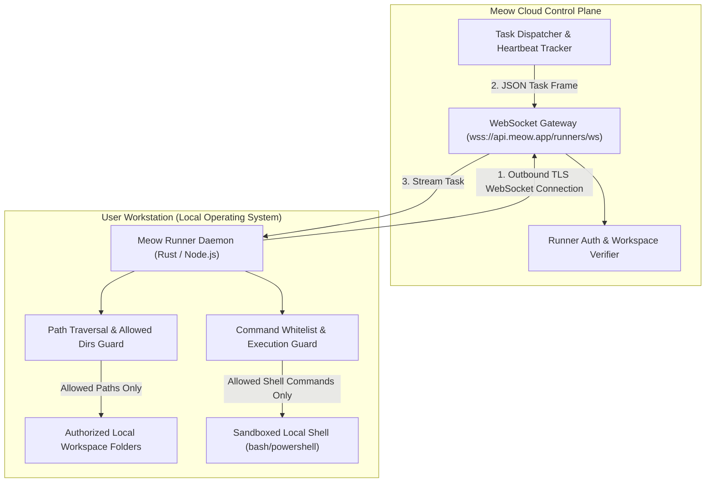
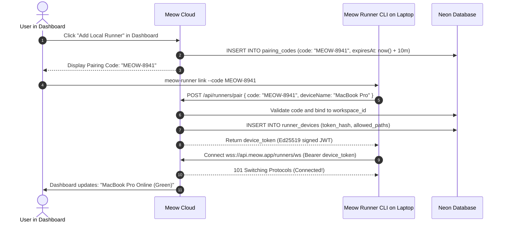
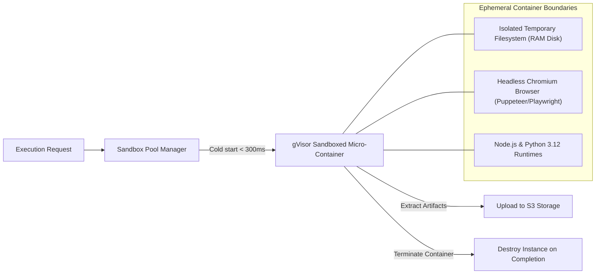

# 06 — Meow Runner & Execution Runtimes

Meow operates a hybrid execution plane: tasks can run either in **ephemeral cloud container sandboxes** or directly on a user's local machine via the **Meow Runner**.

---

## 1. Meow Runner — Local Daemon Architecture

The Meow Runner allows agents to safely interact with local code repositories, run developer tools (Git, npm, compiler suites), and edit local files without exposing the user's host system to arbitrary network vulnerabilities.



### Security Rule: Outbound Connections Only
Traditional developer tools often ask users to open local ports or run `ngrok`. This is insecure.
The Meow Runner connects **outward** to Meow Cloud using standard WSS (WebSocket over TLS). It never binds to local listening ports (`0.0.0.0`), preventing inbound network attacks.

---

## 2. Pairing & Device Authorization Flow



---

## 3. Local Filesystem Sandboxing & Path Whitelisting

The runner configuration file (`~/.meow/runner.json`) enforces strict local directory boundaries:

```json
{
  "version": 1,
  "deviceId": "dev_01jbc55x",
  "allowedDirectories": [
    "C:\\Users\\manis\\workspace\\meow-agent-projects",
    "C:\\Users\\manis\\documents\\approved-reports"
  ],
  "allowShellExecution": false,
  "maxFileSizeBytes": 52428800
}
```

### Path Traversal Defense Algorithm:
Before reading or writing any file:
```typescript
export function validateLocalPath(requestedPath: string, allowedDirs: string[]): string {
  const resolved = path.resolve(requestedPath);

  const isAllowed = allowedDirs.some((allowedDir) => {
    const resolvedAllowed = path.resolve(allowedDir);
    const relative = path.relative(resolvedAllowed, resolved);
    return !relative.startsWith("..") && !path.isAbsolute(relative);
  });

  if (!isAllowed) {
    throw new SecurityException(`Path "${resolved}" is outside authorized workspace directories.`);
  }

  return resolved;
}
```
Attempts to access `C:\Windows\System32`, `~/.ssh/id_rsa`, or `/etc/shadow` are rejected on the client side before any disk I/O occurs.

---

## 4. Cloud Container Sandbox Fleet

For autonomous background tasks, web scraping, and code execution that do not require local machine access, Meow provisions disposable cloud sandboxes.



### Container Resource Bounds:
- **CPU:** 1.0 vCPU limit.
- **RAM:** 1024 MB RAM limit (OOM killed on exceed).
- **Execution Lifetime:** Hard termination after 15 minutes.
- **Network Egress:** Restricted to standard HTTP/HTTPS ports (80/443). Internal cloud metadata endpoints (`169.254.169.254`) are blocked via iptables.

---

## 5. Execution Target Routing Matrix

| Execution Target | When Chosen | Behavior |
|---|---|---|
| **`cloud`** | Always cloud | Dispatches job to Inngest cloud container fleet. Works 24/7 even if user's PC is powered off. |
| **`local`** | Explicitly local | Dispatches job to the active Meow Runner WebSocket. If runner is offline, job enters `waiting_for_runner`. |
| **`auto`** | Dynamic evaluation | If task requires local tools (`read_file` on host directory) $\rightarrow$ routes to **local**. If task is web research or cron $\rightarrow$ routes to **cloud**. |

