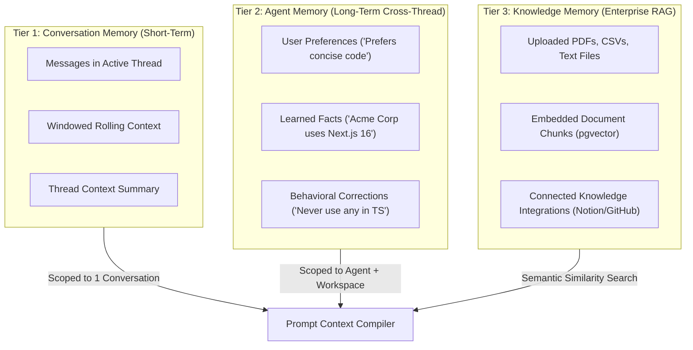
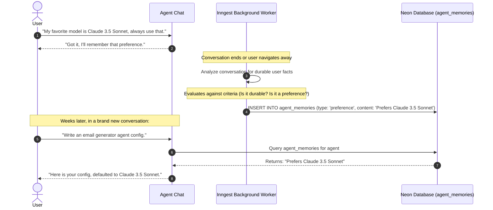
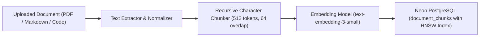

# 07 — Memory Architecture & Knowledge Retrieval (RAG)

Meow agents require memory to be truly personal and context-aware. This document details the three-tier memory architecture, background fact extraction, and document retrieval using PostgreSQL `pgvector`.

---

## 1. The Three Tiers of Agent Memory



---

## 2. Memory Extraction & Reflection Pipeline

Agents should not blindly save every message to long-term memory. A background reflection worker analyzes completed conversations to extract durable facts:



### Memory Extraction System Prompt:
```
You are a Memory Extraction Assistant. Analyze the dialogue and extract ONLY persistent user facts, preferences, or project guidelines.
Do NOT extract ephemeral tasks or conversational pleasantries.
Format as JSON:
[
  { "memoryType": "preference", "content": "User prefers TypeScript over JavaScript" },
  { "memoryType": "fact", "content": "Target production deployment is AWS us-east-1" }
]
```

---

## 3. Knowledge Memory: Document Ingestion & RAG Pipeline

When users upload PDFs, API documentation, or spreadsheets, Meow indexes them using **Neon PostgreSQL with pgvector**.



### Relational Schema for Document Chunks with Vector Embeddings:
```sql
CREATE EXTENSION IF NOT EXISTS vector;

CREATE TABLE "document_chunks" (
    "id" text PRIMARY KEY DEFAULT gen_random_uuid()::text,
    "workspace_id" text NOT NULL REFERENCES "workspaces"("id") ON DELETE CASCADE,
    "file_id" text NOT NULL REFERENCES "files"("id") ON DELETE CASCADE,
    "chunk_index" integer NOT NULL,
    "content" text NOT NULL,
    "embedding" vector(1536) NOT NULL,
    "metadata" jsonb DEFAULT '{}'::jsonb NOT NULL,
    "created_at" timestamp DEFAULT now() NOT NULL
);

-- Fast Approximate Nearest Neighbor (ANN) index using HNSW
CREATE INDEX "document_chunks_embedding_hnsw_idx" 
ON "document_chunks" 
USING hnsw ("embedding" vector_cosine_ops)
WITH (m = 16, ef_construction = 64);
```

---

## 4. Semantic Similarity Search Query

When a user asks a question, Meow computes the query embedding and retrieves the top-K relevant chunks within the user's workspace using cosine distance (`<=>`):

```typescript
export async function searchKnowledgeBase(
  workspaceId: string,
  queryText: string,
  topK: number = 5,
): Promise<Array<{ content: string; similarity: number }>> {
  // 1. Generate embedding vector for query
  const queryEmbedding = await generateEmbedding(queryText);

  // 2. Perform Cosine Similarity Search in Neon PostgreSQL
  const results = await db.execute(sql`
    SELECT 
      content,
      1 - (embedding <=> ${JSON.stringify(queryEmbedding)}::vector) AS similarity
    FROM document_chunks
    WHERE workspace_id = ${workspaceId}
    ORDER BY embedding <=> ${JSON.stringify(queryEmbedding)}::vector
    LIMIT ${topK};
  `);

  return results as unknown as Array<{ content: string; similarity: number }>;
}
```

---

## 5. User Privacy & Right to Erasure (GDPR)

Users have complete visibility and control over what the AI platform remembers:
1. **Inspection UI:** Users can view the **Memory & Knowledge** tab in Workspace Settings.
2. **Individual Deletion:** Users can edit or delete any stored memory fact or uploaded document.
3. **Workspace Cascade:** Deleting a workspace triggers `ON DELETE CASCADE` across all `agent_memories`, `files`, and `document_chunks`, immediately purging vectors from disk.

