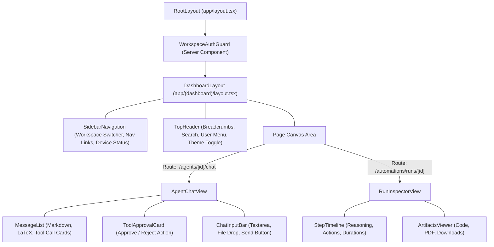

# 09 — Frontend Architecture & UI Design System

This document specifies the Next.js App Router component hierarchy, state management patterns, streaming SSE consumer hooks, and layout wireframes for **Meow**.

---

## 1. Next.js App Router Structure & Layout Architecture

Meow utilizes Next.js 16 with React 19, TypeScript, and Tailwind CSS. The interface is segmented into two primary Route Groups:

```
app/
├── layout.tsx                     <- Global HTML Root, NextThemesProvider, Font Definitions
│
├── (auth)/                        <- Unauthenticated Identity Routes
│   ├── layout.tsx                 <- Clean, minimal auth container
│   ├── sign-in/page.tsx           <- OAuth provider login cards (GitHub & Google)
│   └── sign-up/page.tsx           <- Account creation onboarding
│
└── (dashboard)/                   <- Protected Workspace Layout
    ├── layout.tsx                 <- Tenancy Guard, Left Sidebar & Top Header
    ├── page.tsx                   <- Workspace Overview & Activity Feed
    │
    ├── agents/
    │   ├── page.tsx               <- Agent Gallery & Filter Controls
    │   ├── new/page.tsx           <- Multi-step Agent Creation Wizard
    │   └── [id]/
    │       ├── page.tsx           <- Agent Overview, Versions & Telemetry
    │       ├── edit/page.tsx      <- Instructions, Hyperparameters & Tool Toggles
    │       └── chat/page.tsx      <- Real-time Interactive Chat Canvas
    │
    ├── automations/
    │   ├── page.tsx               <- Routines, Cron Schedules & History
    │   └── runs/[id]/page.tsx     <- Real-time Autonomous Run Inspector
    │
    ├── tools/
    │   ├── page.tsx               <- Built-in Tool Directory & Approvals
    │   └── integrations/page.tsx  <- Connected Google/GitHub Accounts
    │
    ├── execution/
    │   ├── cloud/page.tsx         <- Cloud Container Sandbox Status
    │   └── runners/page.tsx       <- Local Meow Runner Devices & Pairing
    │
    └── settings/
        ├── workspace/page.tsx     <- Slug, Team Members & RBAC Roles
        └── billing/page.tsx       <- Token Usage Records & Cost Meters
```

---

## 2. Component Hierarchy Diagram



---

## 3. Real-Time Streaming Hook: `useAgentStream`

Interactive chat requires reading the Server-Sent Events stream, appending token chunks to the active message, and rendering tool call progress bars.

```typescript
"use client";

import { useState, useCallback } from "react";

export interface StreamMessage {
  id: string;
  role: "user" | "assistant";
  content: string;
  toolCalls?: Array<{ id: string; name: string; status: string; result?: unknown }>;
  isStreaming?: boolean;
}

export function useAgentStream(conversationId: string) {
  const [messages, setMessages] = useState<StreamMessage[]>([]);
  const [isGenerating, setIsGenerating] = useState(false);

  const sendMessage = useCallback(async (content: string) => {
    setIsGenerating(true);

    // 1. Append User Message
    const userMsg: StreamMessage = { id: crypto.randomUUID(), role: "user", content };
    const assistantMsgId = crypto.randomUUID();
    const assistantMsg: StreamMessage = { id: assistantMsgId, role: "assistant", content: "", isStreaming: true };

    setMessages((prev) => [...prev, userMsg, assistantMsg]);

    // 2. Submit user turn to backend
    await fetch(`/api/conversations/${conversationId}/messages`, {
      method: "POST",
      headers: { "Content-Type": "application/json" },
      body: JSON.stringify({ content }),
    });

    // 3. Connect to Server-Sent Events Stream
    const eventSource = new EventSource(`/api/conversations/${conversationId}/stream`);

    eventSource.addEventListener("token", (e) => {
      const data = JSON.parse(e.data);
      setMessages((prev) =>
        prev.map((msg) =>
          msg.id === assistantMsgId ? { ...msg, content: msg.content + data.delta } : msg,
        ),
      );
    });

    eventSource.addEventListener("tool_start", (e) => {
      const data = JSON.parse(e.data);
      setMessages((prev) =>
        prev.map((msg) =>
          msg.id === assistantMsgId
            ? {
                ...msg,
                toolCalls: [...(msg.toolCalls || []), { id: data.callId, name: data.name, status: "executing" }],
              }
            : msg,
        ),
      );
    });

    eventSource.addEventListener("done", () => {
      setMessages((prev) =>
        prev.map((msg) => (msg.id === assistantMsgId ? { ...msg, isStreaming: false } : msg)),
      );
      setIsGenerating(false);
      eventSource.close();
    });

    eventSource.onerror = () => {
      setIsGenerating(false);
      eventSource.close();
    };
  }, [conversationId]);

  return { messages, isGenerating, sendMessage };
}
```

---

## 4. UI Dashboard Wireframe & Screen Architecture

```
+---------------------------------------------------------------------------------------------------+
|  [Meow Logo]  [ Acme Engineering v ]                      [ Search (Cmd+K) ]  [ Moon/Sun ] [User]  |
+-------------------+-------------------------------------------------------------------------------+
|  NAVIGATION       |  AGENT CHAT: Research Assistant (v2)               [ Settings ] [ Share ]     |
|                   +-------------------------------------------------------------------------------+
|  Overview         |                                                                               |
|  * Agents         |  [User]: Compare the token pricing of Gemini 2.0 Flash vs Claude 3.5 Sonnet.  |
|    - Research Bot |                                                                               |
|    - Coding Bot   |  [Assistant]: Let me retrieve the latest published provider rate cards.       |
|  * Chat           |  +-------------------------------------------------------------------------+  |
|  * Automations    |  | > TOOL CALL: web_search({ query: "Gemini 2.0 Flash vs Claude pricing" })   |  |
|  * Tool Library   |  |   Status: Completed in 380ms (4 sources verified)                         |  |
|  * Integrations   |  +-------------------------------------------------------------------------+  |
|  * Local Runners  |                                                                               |
|    - Mac (Online) |  Here is the side-by-side comparative summary:                                |
|  * Settings       |  1. Gemini 2.0 Flash: $0.10 / 1M prompt tokens, $0.40 / 1M completion.        |
|                   |  2. Claude 3.5 Sonnet: $3.00 / 1M prompt tokens, $15.00 / 1M completion.      |
|                   |                                                                               |
|                   |  +-------------------------------------------------------------------------+  |
|                   |  | Send a message or command... (/plan, /goal)                  [ Send ^ ] |  |
+-------------------+-------------------------------------------------------------------------------+
```

