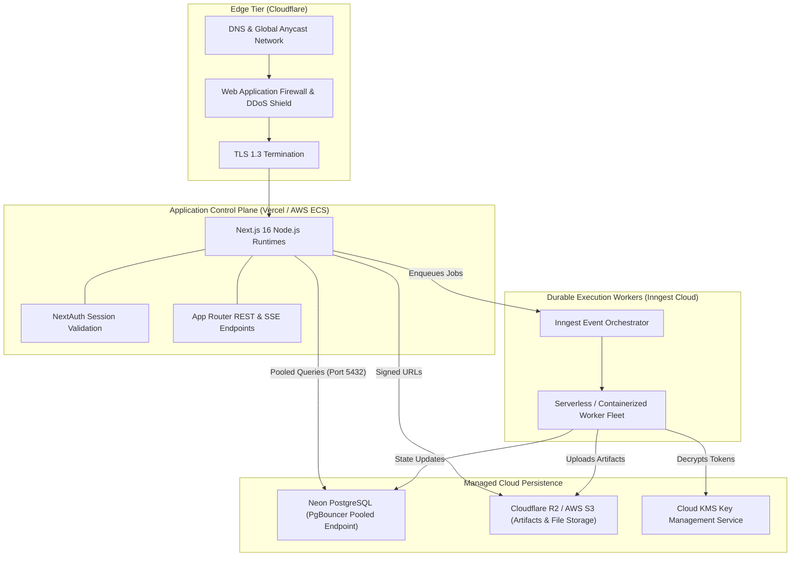
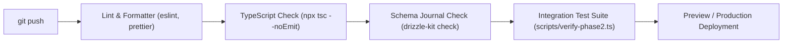

# 11 — DevOps, Deployment & Observability Blueprint

This document details the production infrastructure, database pooling configurations, CI/CD pipelines, structured observability, and disaster recovery strategies for **Meow**.

---

## 1. Production Deployment Topology



---

## 2. Serverless Database Connection Pooling (Neon + postgres.js)

Because Next.js executes across distributed serverless instances, naive connection pooling can quickly saturate database connection limits.

### Configuration (`db/index.ts`):
```typescript
import { drizzle } from 'drizzle-orm/postgres-js';
import postgres from 'postgres';
import * as schema from '@/db/schema';

const databaseUrl = process.env.DATABASE_URL || 'postgresql://placeholder-url';

const client = postgres(databaseUrl, {
  prepare: false,      // Required for Neon / PgBouncer transaction connection pooling!
  max: 10,             // Max client connections per serverless container
  idle_timeout: 20,    // Reclaim connections idle for 20 seconds
  connect_timeout: 10, // Fail fast on network partitions
});

export const db = drizzle({ client, schema });
export * from '@/db/schema';
```

---

## 3. Environment Variables & Secrets Hierarchy

| Variable | Description | Environment | Sensitive |
|---|---|---|:---:|
| `DATABASE_URL` | Neon PostgreSQL pooled connection string | All | **Yes** |
| `NEXTAUTH_URL` | Canonical application URL (`https://meow.app`) | All | No |
| `NEXTAUTH_SECRET` | 256-bit secret used to sign and encrypt JWTs | All | **Yes** |
| `GITHUB_CLIENT_ID` | OAuth App Client ID for GitHub login | All | No |
| `GITHUB_CLIENT_SECRET` | OAuth App Client Secret for GitHub login | All | **Yes** |
| `GOOGLE_CLIENT_ID` | OAuth App Client ID for Google login | All | No |
| `GOOGLE_CLIENT_SECRET` | OAuth App Client Secret for Google login | All | **Yes** |
| `INNGEST_EVENT_KEY` | Inngest event ingestion API key | Production | **Yes** |
| `INNGEST_SIGNING_KEY`| Inngest function signing verification key | Production | **Yes** |
| `KMS_MASTER_KEY` | AES-256 master key for credential vault | Production | **Yes** |
| `S3_BUCKET_NAME` | Cloud storage bucket for files and reports | Production | No |

---

## 4. Structured Observability & Distributed Tracing

Meow emits structured JSON logs formatted for Datadog, Axiom, or OpenTelemetry ingest:

```json
{
  "timestamp": "2026-11-01T08:42:01.129Z",
  "level": "INFO",
  "traceId": "tr_01jbc88x",
  "workspaceId": "ws_12345",
  "actorId": "usr_789",
  "event": "agent.step_completed",
  "agentId": "agent_abc",
  "version": 2,
  "step": 3,
  "tool": "web_search",
  "durationMs": 412,
  "tokens": {
    "prompt": 540,
    "completion": 120,
    "total": 660
  },
  "costUsd": 0.00018
}
```

### Real-Time Health & Status Checks:
- `GET /api/health`: Validates database connectivity (`SELECT 1`), Inngest queue heartbeat, and edge cache status.

---

## 5. CI/CD Automated Verification Pipeline

Every Pull Request automatically executes a 4-stage GitHub Actions verification workflow:



---

## 6. Disaster Recovery & Backup Guarantees

1. **Continuous Point-in-Time Recovery (PITR):** Neon serverless WAL logs provide instant database rollback to any millisecond within the previous 30 days.
2. **Zero Orphan Guarantee:** Database foreign keys enforce `ON DELETE CASCADE` or `RESTRICT`, preventing corrupted, orphaned records.
3. **Multi-Region Object Storage:** User artifacts in S3 / R2 are replicated across multiple geographic regions with 99.999999999% (11 9's) durability.

