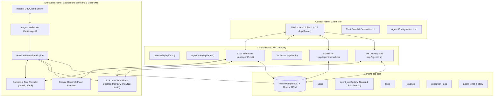

# Meow Bot — Engineering Knowledge Base & Learning System

Welcome to the internal engineering documentation and architectural reference for **Meow Bot**, an autonomous AI agent SaaS platform built with Next.js 15, Vercel AI SDK, Google Gemini 3 Flash, Neon PostgreSQL, Drizzle ORM, Composio, and Inngest.

---

## Architecture Blueprint Overview

---

## Chapter Index

| Chapter | Title | Topics Covered | Status |
| :--- | :--- | :--- | :--- |
| **Ch. 01–06** | [Foundations & Auth](chapters/chapter-01-to-06/README.md) | Next.js 15, NextAuth, Neon PostgreSQL, Drizzle ORM, Agent Wizard | Documented |
| **Ch. 07–10** | [Inference & Tool Integration](chapters/chapter-07-to-10/README.md) | Gemini 3 Flash, Vercel AI SDK v7, Composio OAuth, Gmail Setup | Documented |
| **Ch. 11–14** | [Generative UI & Routine Lifecycle](chapters/chapter-11-to-14/README.md) | Structured Output, RoutineCard, Tool Badging, Schedule Persistence | Current |
| **Ch. 15** | [Durable Background Execution](chapters/chapter-15/README.md) | Inngest Cron, Step Execution, Payload Trimming, Execution Logs | Documented |
| **Ch. 16** | [Chat Persistence & History](chapters/chapter-16/README.md) | PostgreSQL Chat Threads, Message Restoration, Routine Inbox | Documented |
| **Ch. 17** | [VM Desktop Sandbox](chapters/chapter-17/README.md) | E2B Cloud Desktop, Live Browser Automation, VNC Viewport | Documented |
| **Ch. 18** | [Marketplace & Settings](chapters/chapter-18/README.md) | Tool Marketplace Dialog, Pause Agent, Danger Zone Deletion | Documented |
| **Ch. 19** | [Production Deployment](chapters/chapter-19/README.md) | Vercel Deployment, Inngest Cloud Sync, Domain Configuration | Current |
