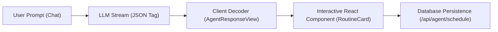

# Chapter 11 to 14: Generative UI, Routine Lifecycle & Tool OAuth

## 1. Chapter Objectives
1. Understand how an AI agent detects automation intent and transitions from standard text chatting to structured workflow generation.
2. Build a typed contract between LLM output and frontend UI using Zod schemas.
3. Implement **Generative UI** in React: rendering live, actionable components (`RoutineCard`, `ToolSuggestionCard`) inside a streaming chat feed.
4. Establish tool dependency mapping: checking which required tools are authenticated and providing one-click OAuth authorization directly from the chat card.
5. Persist scheduled routines into Neon PostgreSQL (`routines` table) to feed the Inngest background engine.

---

## 2. Problem Statement
In traditional chatbot architectures, all interactions are flattened into plain text strings. When a user requests:
> *"Summarize my top unread emails and ping me on Slack every day at 8 AM"*

A text-only chatbot either:
* Hallucinates that it set an alarm (without writing to a database or scheduler).
* Attempts to run the task immediately (failing because Slack is not authenticated).
* Asks open-ended natural language questions, forcing the user to guess how to confirm.

**The Solution:** Generative UI. The LLM compiles unstructured natural language into a typed data structure. The client decodes this structure and mounts an interactive React component with live database checks, one-click OAuth triggers, and a deterministic confirmation button.

---

## 3. Core Theoretical Concepts

### A. Control Plane vs. Execution Plane
* **Control Plane (The "What"):** Handled in Next.js API routes and React components. The user designs, configures, connects tools, and approves workflows.
* **Execution Plane (The "How"):** Handled by background workers (Inngest). Long-running tasks, cron schedules, retries, and API rate-limiting occur here, decoupled from the user's browser.

### B. Structured Output vs. Autonomous Tool Calling
* **Tool Calling:** The model generates function call arguments (`GMAIL_FETCH_EMAILS`), halts generation, waits for tool output, and incorporates tool data into its final response.
* **Structured Output:** The model acts as a compiler. It parses user intent against an application schema (`agentResponseSchema`) and outputs a JSON tree.

### C. Generative UI Architecture


---

## 4. File-by-File Implementation Walkthrough

### 1. `lib/ai/agent_response_schema.ts`
* **Purpose:** Single source of truth defining the typed structure for agent outputs.
* **Key Schemas:**
  * `routineSchema`: Captures `name`, `goal`, `instruction`, `frequency`, `scheduledTime`, `timezone`, and `tools`.
  * `agentResponseSchema`: Defines the polymorphic output types: `message`, `clarification`, or `routine`.

### 2. `app/api/agent/chat/route.ts`
* **Purpose:** Real-time conversational endpoint.
* **Key Changes:**
  * Queries the `tools` table in Neon DB to provide Gemini with a complete catalog of available platform tools.
  * Injects the user's browser `timezone`.
  * Enforces the routine protocol in the system prompt.
  * Wraps active Composio tools in resilient try/catch handlers and trims oversized email payloads.

### 3. `components/custom/agent-space/routine-card.tsx`
* **Purpose:** The Generative UI widget mounted in the chat.
* **Key Behaviors:**
  * Dynamically queries `/api/tools` on mount to check which tools are authenticated.
  * Compares required tools with connected tools, displaying green badges for active tools and amber badges for missing ones.
  * Provides inline `+ Connect` action buttons to trigger Composio OAuth popups.
  * Provides the `Create Routine` action button that persists the routine to the database.

### 4. `components/custom/agent-space/agent-response-view.tsx`
* **Purpose:** Safe rendering dispatcher.
* **Key Behaviors:**
  * Displays raw text while streaming is active.
  * Safely parses JSON payloads (including JSON fenced in code blocks) using `try/catch`.
  * Mounts `<RoutineCard />` for `routine` payloads and clarification alerts for `clarification` payloads.
  * Falls back to standard markdown formatting if JSON parsing fails.

---

## 5. Complete Runtime Execution Flow

```
1. User clicks prompt chip or types:
   "Summarize my top unread emails and alert me on Slack every day at 8 AM"
   
2. Frontend ChatPanel dispatches:
   POST /api/agent/chat { agentId, messages, timezone }

3. Route Handler:
   - Validates user session via getServerSession(authOptions).
   - Queries Neon DB for active tools catalog.
   - Compiles system instructions with routine protocols.
   - Streams request to Google Gemini 3 Flash.

4. Gemini Engine:
   - Recognizes routine intent.
   - Maps required tools: ["GMAIL", "SLACK"].
   - Emits structured JSON payload.

5. Client-Side Rendering:
   - AgentResponseView parses JSON payload.
   - Mounts <RoutineCard /> directly inside the chat timeline.
   - Queries /api/tools: detects Gmail is connected, Slack requires auth.

6. User Action:
   - Clicks "+ Connect" on Slack badge -> opens Composio OAuth popup.
   - Clicks "Create Routine".

7. Persistence:
   - POST /api/agent/schedule inserts record into 'routines' table.
   - Routine appears in the Schedule tab, ready for Inngest cron execution.
```

---

## 6. Testing & Verification

* **Command:** `npx tsc --noEmit`  
  *Result:* 0 errors. TypeScript compilation passed cleanly across all components.
* **Script Verification:** `node ./scripts/test-routine-card.cjs`  
  *Result:* Successfully generated and parsed a routine draft against Google Gemini 3 Flash:
  * Name: `Daily Email Briefing & Slack Alert`
  * Frequency: `daily`
  * Scheduled Time: `08:00 AM UTC`
  * Required Tools: `['GMAIL', 'SLACK']`
* **Database Verification:** Verified `routines` table exists in Neon PostgreSQL with foreign keys to `agent_config` and `users`.

---

## 7. Engineering Trade-offs

1. **Client-Side JSON Parsing vs. AI SDK Generative UI Components:**
   * *Trade-off:* We opted for structured JSON payloads parsed by `AgentResponseView` over tightly coupled Server Actions.
   * *Rationale:* Structured JSON is database-serializable, portable, and allows re-rendering historical cards without maintaining server action references.
2. **Dynamic Tool Catalog vs. Static Hardcoded Tools:**
   * *Trade-off:* We query the `tools` table from PostgreSQL in the chat route rather than hardcoding a list of tools.
   * *Rationale:* Allows adding new tools in the database without redeploying backend code.

---

## 8. Common Mistakes & Edge Cases
* **Oversized API Responses:** Unfiltered Gmail or GitHub API payloads can exceed 300KB (>75k tokens), exhausting Google AI Studio token limits (429 errors). Always extract only required fields (`subject`, `from`, `snippet`, `date`).
* **Timezone Misalignment:** Server clocks operate in UTC, while users operate in local timezones. Always send `Intl.DateTimeFormat().resolvedOptions().timeZone` from the browser to the backend.
* **Premature Stream Termination:** In AI SDK v7, ensure `stopWhen: isStepCount(...)` allows at least 5 steps so tool execution can complete before text synthesis.
