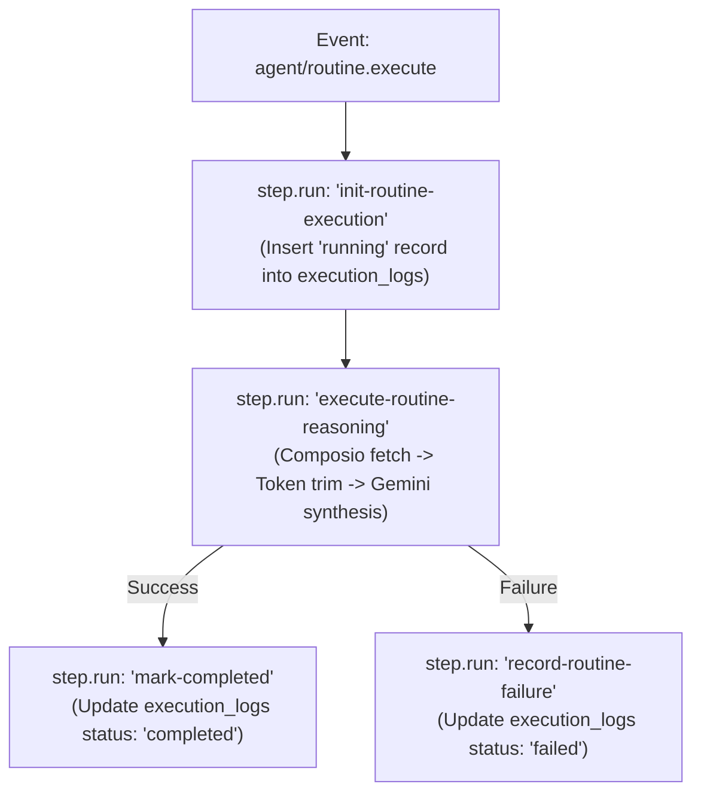

# Chapter 15: Durable Background Routines & Inngest Execution Engine

## 1. Chapter Objectives
1. Understand why traditional HTTP API routes cannot support long-running, autonomous background workflows.
2. Master the principles of **Durable Execution**: step-level memoization, automatic retries, and distributed state machines.
3. Configure **Inngest** as the orchestration engine for recurring agent routines and on-demand background runs.
4. Build the core agent execution engine (`routine-runner.ts`) combining Composio tool invocation, payload sanitization, and Gemini 3 Flash synthesis.
5. Store immutable execution audit logs in PostgreSQL and stream real-time execution status to the UI.

---

## 2. Problem Statement
In SaaS platforms like Meow Bot, an AI agent must perform complex, multi-step tasks on a schedule (e.g. at 8:00 AM every day: connect to Gmail, fetch unread emails, filter security alerts, synthesize an executive summary, and dispatch it to Slack).

Doing this inside a standard Next.js API route (`fetch` inside `route.ts`) introduces severe architectural failure modes:
1. **HTTP Timeouts:** Serverless functions (Vercel/AWS Lambda) enforce strict execution timeouts (10s to 60s). Multi-tool agent reasoning easily exceeds this limit.
2. **Lack of Durability:** If an API route fails midway (e.g. Gmail succeeds, but the LLM call times out), the entire process crashes. The user has no record of failure, and there is no automatic retry mechanism.
3. **No Scheduling Layer:** Next.js has no native cron scheduler to trigger routines independently of user browser sessions.

**The Solution:** Decouple the Control Plane from the Execution Plane using **Inngest**.

---

## 3. Core Theoretical Concepts

### A. What is Durable Execution?
In standard programming, when a function crashes on line 50, the execution dies and all memory is lost.

In **Durable Execution** (powered by Inngest):
* Workflows are broken into deterministic **`step.run()`** blocks.
* When a step succeeds, its return value is persisted (memoized) in Inngest's state engine.
* If step 3 fails due to a network glitch, Inngest does not restart from step 1. It resumes execution directly at step 3 with automatic exponential backoff.



### B. Payload Sanitization & Token Quota Protection
Third-party APIs (Gmail, GitHub) return massive JSON payloads. A raw Gmail thread with base64 attachments can easily exceed 300,000 characters (~75,000 tokens).
* If 5 emails are passed directly to an LLM, the request will instantly breach Google AI Studio's free tier rate limit (**250,000 tokens/minute**), throwing a `429 RESOURCE_EXHAUSTED` error.
* **Our Solution:** A sanitization layer inside `routine-runner.ts` that intercepts responses exceeding 25KB, extracting only key metadata (`subject`, `from`, `snippet`, `date`) and discarding raw MIME headers and base64 payloads.

---

## 4. File-by-File Implementation Walkthrough

### 1. `lib/inngest/client.ts`
* **Purpose:** Initializes the Inngest client.
* **Key Detail:** Handles local development vs. production mode:
```typescript
import { Inngest } from "inngest";

export const inngest = new Inngest({
  id: "meow-bot",
  // In development, communicates with the local Inngest Dev Server (http://127.0.0.1:8288)
  eventKey: process.env.INNGEST_EVENT_KEY || undefined,
});
```

### 2. `lib/inngest/functions.ts`
* **Purpose:** Defines the durable background functions.
* **Key Functions:**
  1. `executeAgentRoutineJob`: Triggered by event `agent/routine.execute`. Executes `init-routine-execution`, calls `runAgentRoutineLogic`, and handles failure records.
  2. `dailyAgentRoutinesCronJob`: Triggered by cron `0 8 * * *`. Queries all active routines from Neon DB and dispatches execution events.

### 3. `lib/inngest/routine-runner.ts`
* **Purpose:** The core autonomous execution engine.
* **Execution Sequence:**
  1. Loads routine parameters and agent persona from PostgreSQL.
  2. Queries active Composio tools for the user (`session.user.email`).
  3. Wraps tool execution in a payload trimmer (capping payloads at 25KB).
  4. Calls `generateText({ model: defaultGeminiModel, stopWhen: isStepCount(5), tools: dynamicTools })`.
  5. Updates `execution_logs` with status `completed` and the synthesized markdown summary.
  6. Updates `routines.lastRunAt` with the current timestamp.

### 4. `app/api/inngest/route.ts`
* **Purpose:** The Next.js Route Handler exposing Inngest's HTTP webhook:
```typescript
import { serve } from "inngest/next";
import { inngest } from "@/lib/inngest/client";
import { executeAgentRoutineJob, dailyAgentRoutinesCronJob } from "@/lib/inngest/functions";

export const { GET, POST, PUT } = serve({
  client: inngest,
  functions: [executeAgentRoutineJob, dailyAgentRoutinesCronJob],
});
```

### 5. `components/custom/agent-space/schedule-tab.tsx`
* **Purpose:** The frontend dashboard for monitoring and triggering routines.
* **Key Features:**
  * Displays active routine cards with frequency and scheduled time.
  * **"Run Now" button:** Sends `POST /api/agent/schedule/run-now` to trigger instant execution.
  * **Auto-Polling:** When a routine is in the `running` state, polls `/api/agent/schedule` every 2.5 seconds until completion.
  * **Expandable Audit Log:** Allows expanding past runs to read the formatted Markdown report.

---

## 5. Complete Runtime Flow (Manual Run)

```
1. User clicks "Run Now" in the Schedule Tab.
2. Frontend sends: POST /api/agent/schedule/run-now { routineId, agentId }
3. API Route inserts an initial record into 'execution_logs' (status: 'running').
4. API Route dispatches event to Inngest client:
   inngest.send({ name: 'agent/routine.execute', data: { routineId, executionId, agentId } })
5. Inngest worker picks up event and executes 'executeAgentRoutineJob'.
6. 'routine-runner.ts' calls Composio Gmail tool to fetch unread emails.
7. Payload trimmer extracts subject, from, snippet.
8. Gemini 3 Flash synthesizes a structured Markdown executive briefing.
9. Database record updated: status 'completed', resultSummary written.
10. UI auto-poller detects 'completed' status, updates badge to green, and renders the briefing report!
```

---

## 6. Real Verification Test Run

Verified live against a real Gmail account connected via Composio:
* **Execution ID:** `exec_1794848662540`
* **Status:** `completed`
* **Generated Summary:**
  > ### 📬 Executive Email Briefing & Triage
  > **1. 🚨 Security & Account Alerts (High Priority)**
  > * Composio Integration & InstaBox OAuth permissions granted.
  > * 2-Step Verification enabled on Google account.
  > **2. ⚠️ Service Notifications (Medium Priority)**
  > * Vercel production build failure alert for project "meow".
  > **3. 📋 Recommended Action Items**
  > * Investigate Vercel deployment log.
