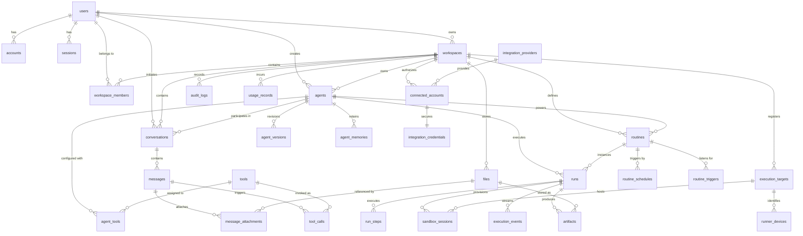

# 01 — Complete Database ERD & Domain Schema Specification

This document provides the definitive data architecture for **Meow**, spanning all 8 functional domains. It specifies entity relationships, primary keys, foreign keys, cascading rules, unique indexes, check constraints, and Drizzle schema structures.

---

## 1. Relational Entity-Relationship Diagram (ERD)

---

## 2. Domain Entities Specification

### Domain A: Identity & Tenancy (Existing & Verified in Phase 1 & 2)

#### 1. `users`
Global identity for human actors.
- `id` (`text`, PK, default `gen_random_uuid()::text`)
- `name` (`text`, nullable)
- `email` (`text`, unique, not null)
- `emailVerified` (`timestamp`, nullable)
- `image` (`text`, nullable)
- `createdAt` (`timestamp`, default `now()`, not null)

#### 2. `accounts`
OAuth provider link (Auth.js compliant).
- `userId` (`text`, not null, FK -> `users.id`, `onDelete: cascade`)
- `type` (`text`, not null)
- `provider` (`text`, not null)
- `providerAccountId` (`text`, not null)
- `refresh_token`, `access_token`, `expires_at`, `token_type`, `scope`, `id_token`, `session_state`
- **PK:** Composite `(provider, providerAccountId)`
- **Index:** `user_id_idx` on `userId`

#### 3. `workspaces`
Multi-tenant isolation root.
- `id` (`text`, PK, default `gen_random_uuid()::text`)
- `name` (`text`, not null)
- `slug` (`text`, unique, not null)
- `ownerUserId` (`text`, not null, FK -> `users.id`, `onDelete: restrict`)
- `createdAt`, `updatedAt` (`timestamp`, default `now()`, not null)
- **Index:** `workspaces_owner_user_id_idx` on `ownerUserId`

#### 4. `workspace_members`
Tenancy membership & role assignment.
- `workspaceId` (`text`, not null, FK -> `workspaces.id`, `onDelete: cascade`)
- `userId` (`text`, not null, FK -> `users.id`, `onDelete: cascade`)
- `role` (`text`, not null, default `'member'`, check `in ('owner', 'admin', 'member')`)
- `joinedAt` (`timestamp`, default `now()`, not null)
- **PK:** Composite `(workspaceId, userId)`
- **Index:** `workspace_members_user_id_idx` on `userId`

---

### Domain B: Agent Ecosystem

#### 5. `agents` (Implemented & Verified in Phase 2)
The root metadata container for an AI agent.
- `id` (`text`, PK, default `gen_random_uuid()::text`)
- `workspaceId` (`text`, not null, FK -> `workspaces.id`, `onDelete: cascade`)
- `name` (`text`, not null)
- `description` (`text`, nullable)
- `status` (`text`, not null, default `'active'`, check `in ('active', 'archived')`)
- `createdBy` (`text`, not null, FK -> `users.id`, `onDelete: restrict`)
- `createdAt`, `updatedAt` (`timestamp`, default `now()`, not null)
- **Index:** `agents_workspace_id_idx` on `workspaceId`

#### 6. `agent_versions` (Implemented & Verified in Phase 2)
Immutable version ledger for prompts, models, and hyperparameters.
- `id` (`text`, PK, default `gen_random_uuid()::text`)
- `agentId` (`text`, not null, FK -> `agents.id`, `onDelete: cascade`)
- `version` (`integer`, not null, check `version > 0`)
- `instructions` (`text`, not null)
- `model` (`text`, not null)
- `config` (`jsonb`, not null, default `'{}'::jsonb`)
- `createdBy` (`text`, not null, FK -> `users.id`, `onDelete: restrict`)
- `createdAt` (`timestamp`, default `now()`, not null)
- **Unique Constraint:** `(agentId, version)`
- **Index:** `agent_versions_agent_id_idx` on `agentId`

#### 7. `agent_tools` (Planned: Phase 4)
Associates capabilities to an agent.
- `id` (`text`, PK, default `gen_random_uuid()::text`)
- `agentId` (`text`, not null, FK -> `agents.id`, `onDelete: cascade`)
- `toolId` (`text`, not null, FK -> `tools.id`, `onDelete: cascade`)
- `enabled` (`boolean`, not null, default `true`)
- `configOverride` (`jsonb`, default `'{}'::jsonb`, not null)
- `createdAt` (`timestamp`, default `now()`, not null)
- **Unique Constraint:** `(agentId, toolId)`

#### 8. `agent_memories` (Planned: Phase 5)
Cross-conversation long-term facts and user preferences.
- `id` (`text`, PK, default `gen_random_uuid()::text`)
- `agentId` (`text`, not null, FK -> `agents.id`, `onDelete: cascade`)
- `memoryType` (`text`, not null, check `in ('fact', 'preference', 'instruction', 'summary')`)
- `content` (`text`, not null)
- `metadata` (`jsonb`, default `'{}'::jsonb`, not null)
- `createdAt` (`timestamp`, default `now()`, not null)
- **Index:** `agent_memories_agent_id_idx` on `agentId`

---

### Domain C: Conversations & Messages (Planned: Phase 3)

#### 9. `conversations`
A multi-turn chat thread between a user and an agent.
- `id` (`text`, PK, default `gen_random_uuid()::text`)
- `workspaceId` (`text`, not null, FK -> `workspaces.id`, `onDelete: cascade`)
- `agentId` (`text`, not null, FK -> `agents.id`, `onDelete: cascade`)
- `agentVersionId` (`text`, not null, FK -> `agent_versions.id`, `onDelete: restrict`)
- `title` (`text`, not null, default `'New Conversation'`)
- `createdBy` (`text`, not null, FK -> `users.id`, `onDelete: restrict`)
- `createdAt`, `updatedAt` (`timestamp`, default `now()`, not null)
- **Index:** `conversations_workspace_id_idx` on `workspaceId`, `conversations_agent_id_idx` on `agentId`

#### 10. `messages`
Individual message turn.
- `id` (`text`, PK, default `gen_random_uuid()::text`)
- `conversationId` (`text`, not null, FK -> `conversations.id`, `onDelete: cascade`)
- `role` (`text`, not null, check `in ('user', 'assistant', 'system', 'tool')`)
- `content` (`text`, not null)
- `metadata` (`jsonb`, default `'{}'::jsonb`, not null)
- `createdAt` (`timestamp`, default `now()`, not null)
- **Index:** `messages_conversation_id_idx` on `conversationId`

#### 11. `message_attachments`
Files or images attached to a user or agent message.
- `id` (`text`, PK, default `gen_random_uuid()::text`)
- `messageId` (`text`, not null, FK -> `messages.id`, `onDelete: cascade`)
- `fileId` (`text`, not null, FK -> `files.id`, `onDelete: cascade`)
- `createdAt` (`timestamp`, default `now()`, not null)

#### 12. `tool_calls`
Structured record of an LLM tool request and its execution response.
- `id` (`text`, PK, default `gen_random_uuid()::text`)
- `messageId` (`text`, not null, FK -> `messages.id`, `onDelete: cascade`)
- `toolId` (`text`, not null, FK -> `tools.id`, `onDelete: restrict`)
- `callId` (`text`, not null) -- The LLM provider tool_call_id
- `arguments` (`jsonb`, not null)
- `result` (`jsonb`, nullable)
- `status` (`text`, not null, check `in ('requested', 'approved', 'executing', 'completed', 'failed', 'rejected')`)
- `errorMessage` (`text`, nullable)
- `durationMs` (`integer`, nullable)
- `createdAt` (`timestamp`, default `now()`, not null)
- **Index:** `tool_calls_message_id_idx` on `messageId`

---

### Domain D: Tools & Integrations (Planned: Phase 4 & 8)

#### 13. `tools`
System registry of built-in and integration capabilities.
- `id` (`text`, PK) -- e.g. `'web_search'`, `'read_file'`, `'send_email'`
- `name` (`text`, not null)
- `description` (`text`, not null)
- `inputSchema` (`jsonb`, not null) -- JSON Schema specification
- `executionType` (`text`, not null, check `in ('native', 'integration', 'sandbox')`)
- `permissionLevel` (`text`, not null, check `in ('read', 'write', 'dangerous')`)
- `requiresApproval` (`boolean`, not null, default `false`)
- `createdAt` (`timestamp`, default `now()`, not null)

#### 14. `integration_providers`
Catalog of supported third-party providers (Google, GitHub, Slack, Notion).
- `id` (`text`, PK) -- e.g. `'google'`, `'github'`
- `name` (`text`, not null)
- `authType` (`text`, not null, check `in ('oauth2', 'api_key', 'basic')`)
- `scopes` (`text[]`, not null)
- `createdAt` (`timestamp`, default `now()`, not null)

#### 15. `connected_accounts`
OAuth authorization granted by a workspace.
- `id` (`text`, PK, default `gen_random_uuid()::text`)
- `workspaceId` (`text`, not null, FK -> `workspaces.id`, `onDelete: cascade`)
- `providerId` (`text`, not null, FK -> `integration_providers.id`, `onDelete: restrict`)
- `accountIdentifier` (`text`, not null) -- e.g. `team@acme.com`
- `connectedBy` (`text`, not null, FK -> `users.id`, `onDelete: restrict`)
- `createdAt`, `updatedAt` (`timestamp`, default `now()`, not null)
- **Unique Constraint:** `(workspaceId, providerId, accountIdentifier)`

#### 16. `integration_credentials`
AES-256-GCM encrypted tokens for connected accounts.
- `connectedAccountId` (`text`, PK, FK -> `connected_accounts.id`, `onDelete: cascade`)
- `encryptedData` (`text`, not null) -- Ciphertext + IV + AuthTag
- `keyId` (`text`, not null) -- KMS key version
- `expiresAt` (`timestamp`, nullable)
- `updatedAt` (`timestamp`, default `now()`, not null)

---

### Domain E: Automations & Runs (Planned: Phase 6 & 7)

#### 17. `routines`
Saved workflow definitions.
- `id` (`text`, PK, default `gen_random_uuid()::text`)
- `workspaceId` (`text`, not null, FK -> `workspaces.id`, `onDelete: cascade`)
- `agentId` (`text`, not null, FK -> `agents.id`, `onDelete: cascade`)
- `name` (`text`, not null)
- `description` (`text`, nullable)
- `status` (`text`, not null, default `'active'`, check `in ('active', 'paused', 'disabled')`)
- `createdBy` (`text`, not null, FK -> `users.id`, `onDelete: restrict`)
- `createdAt`, `updatedAt` (`timestamp`, default `now()`, not null)
- **Index:** `routines_workspace_id_idx` on `workspaceId`

#### 18. `routine_schedules`
Cron schedule for a routine.
- `routineId` (`text`, PK, FK -> `routines.id`, `onDelete: cascade`)
- `cronExpression` (`text`, not null) -- e.g. `'0 9 * * 1-5'`
- `timezone` (`text`, not null, default `'UTC'`)
- `nextRunAt` (`timestamp`, nullable)

#### 19. `routine_triggers`
Event or webhook trigger configuration.
- `id` (`text`, PK, default `gen_random_uuid()::text`)
- `routineId` (`text`, not null, FK -> `routines.id`, `onDelete: cascade`)
- `triggerType` (`text`, not null, check `in ('webhook', 'github_event', 'email_received')`)
- `secret` (`text`, not null)
- `config` (`jsonb`, not null, default `'{}'::jsonb`)

#### 20. `runs`
One actual autonomous or scheduled execution of an agent task.
- `id` (`text`, PK, default `gen_random_uuid()::text`)
- `workspaceId` (`text`, not null, FK -> `workspaces.id`, `onDelete: cascade`)
- `routineId` (`text`, nullable, FK -> `routines.id`, `onDelete: set null`)
- `agentId` (`text`, not null, FK -> `agents.id`, `onDelete: restrict`)
- `agentVersionId` (`text`, not null, FK -> `agent_versions.id`, `onDelete: restrict`)
- `triggerSource` (`text`, not null, check `in ('chat', 'schedule', 'webhook', 'manual')`)
- `status` (`text`, not null, default `'queued'`, check `in ('queued', 'running', 'waiting_for_approval', 'completed', 'failed', 'cancelled', 'timed_out')`)
- `idempotencyKey` (`text`, unique, nullable)
- `startedAt`, `completedAt` (`timestamp`, nullable)
- `createdAt` (`timestamp`, default `now()`, not null)
- **Index:** `runs_workspace_id_idx` on `workspaceId`, `runs_status_idx` on `status`

#### 21. `run_steps`
Discrete action or reasoning turn inside a run.
- `id` (`text`, PK, default `gen_random_uuid()::text`)
- `runId` (`text`, not null, FK -> `runs.id`, `onDelete: cascade`)
- `stepNumber` (`integer`, not null)
- `stepType` (`text`, not null, check `in ('thought', 'tool_call', 'wait_for_input', 'final_answer')`)
- `input` (`jsonb`, not null)
- `output` (`jsonb`, nullable)
- `status` (`text`, not null, check `in ('running', 'completed', 'failed')`)
- `durationMs` (`integer`, nullable)
- `createdAt` (`timestamp`, default `now()`, not null)
- **Unique Constraint:** `(runId, stepNumber)`

---

### Domain F: Execution Infrastructure (Planned: Phase 9)

#### 22. `execution_targets`
Target runtime environment registry.
- `id` (`text`, PK, default `gen_random_uuid()::text`)
- `workspaceId` (`text`, not null, FK -> `workspaces.id`, `onDelete: cascade`)
- `targetType` (`text`, not null, check `in ('cloud', 'local')`)
- `name` (`text`, not null)
- `status` (`text`, not null, check `in ('online', 'offline', 'busy')`)
- `lastHeartbeatAt` (`timestamp`, nullable)

#### 23. `runner_devices`
Local machine metadata for a registered Meow Runner.
- `id` (`text`, PK, default `gen_random_uuid()::text`)
- `executionTargetId` (`text`, not null, FK -> `execution_targets.id`, `onDelete: cascade`)
- `deviceName` (`text`, not null)
- `platform` (`text`, not null) -- e.g. `'darwin'`, `'win32'`, `'linux'`
- `allowedPaths` (`text[]`, not null)
- `tokenHash` (`text`, not null)

#### 24. `sandbox_sessions`
Isolated cloud container or runner session for a run.
- `id` (`text`, PK, default `gen_random_uuid()::text`)
- `runId` (`text`, not null, FK -> `runs.id`, `onDelete: cascade`)
- `targetId` (`text`, not null, FK -> `execution_targets.id`, `onDelete: restrict`)
- `status` (`text`, not null, check `in ('provisioning', 'active', 'terminated')`)
- `allocatedResources` (`jsonb`, default `'{}'::jsonb`, not null)
- `createdAt`, `terminatedAt` (`timestamp`, nullable)

#### 25. `execution_events`
Append-only log of real-time stream events emitted during an agent run.
- `id` (`serial`, PK)
- `runId` (`text`, not null, FK -> `runs.id`, `onDelete: cascade`)
- `eventType` (`text`, not null) -- e.g. `'token_delta'`, `'tool_started'`, `'tool_finished'`
- `payload` (`jsonb`, not null)
- `createdAt` (`timestamp`, default `now()`, not null)
- **Index:** `execution_events_run_id_idx` on `runId`

---

### Domain G: Files & Artifacts (Planned: Phase 5 & 6)

#### 26. `files`
Workspace file references stored in S3-compatible object storage.
- `id` (`text`, PK, default `gen_random_uuid()::text`)
- `workspaceId` (`text`, not null, FK -> `workspaces.id`, `onDelete: cascade`)
- `storageKey` (`text`, not null, unique)
- `originalFilename` (`text`, not null)
- `mimeType` (`text`, not null)
- `sizeBytes` (`integer`, not null)
- `uploadedBy` (`text`, not null, FK -> `users.id`, `onDelete: restrict`)
- `createdAt` (`timestamp`, default `now()`, not null)

#### 27. `artifacts`
Files and documents produced by an agent run (reports, exports, code bundles).
- `id` (`text`, PK, default `gen_random_uuid()::text`)
- `runId` (`text`, not null, FK -> `runs.id`, `onDelete: cascade`)
- `fileId` (`text`, not null, FK -> `files.id`, `onDelete: cascade`)
- `artifactType` (`text`, not null, check `in ('report', 'dataset', 'code', 'log')`)
- `metadata` (`jsonb`, default `'{}'::jsonb`, not null)
- `createdAt` (`timestamp`, default `now()`, not null)

---

### Domain H: Security, Audit & Usage Billing (Planned: Phase 10)

#### 28. `audit_logs`
Immutable compliance trail for administrative and sensitive operations.
- `id` (`text`, PK, default `gen_random_uuid()::text`)
- `workspaceId` (`text`, not null, FK -> `workspaces.id`, `onDelete: cascade`)
- `actorUserId` (`text`, not null, FK -> `users.id`, `onDelete: restrict`)
- `action` (`text`, not null) -- e.g. `'agent.archive'`, `'tool.approve'`, `'member.remove'`
- `resourceType` (`text`, not null)
- `resourceId` (`text`, not null)
- `details` (`jsonb`, not null, default `'{}'::jsonb`)
- `ipAddress` (`text`, nullable)
- `createdAt` (`timestamp`, default `now()`, not null)
- **Index:** `audit_logs_workspace_id_idx` on `workspaceId`

#### 29. `usage_records`
LLM token and compute metering per execution.
- `id` (`text`, PK, default `gen_random_uuid()::text`)
- `workspaceId` (`text`, not null, FK -> `workspaces.id`, `onDelete: cascade`)
- `runId` (`text`, nullable, FK -> `runs.id`, `onDelete: set null`)
- `model` (`text`, not null)
- `promptTokens` (`integer`, not null)
- `completionTokens` (`integer`, not null)
- `totalTokens` (`integer`, not null)
- `estimatedCostUsd` (`numeric(10, 6)`, not null)
- `createdAt` (`timestamp`, default `now()`, not null)
- **Index:** `usage_records_workspace_id_idx` on `workspaceId`

---

## 3. Database Migration Strategy

To protect database stability, migrations are rolled out incrementally per phase:
1. **Migration 0000 (Applied):** Phase 1 Identity & Workspaces.
2. **Migrations 0001 & 0002 (Applied):** Phase 2 Agents & Immutable Agent Versions.
3. **Migration 0003 (Next - Phase 3):** Conversations, Messages, Attachments, and Tool Call tables.
4. **Migration 0004 (Phase 4):** Tools and Agent Tools tables.
5. **Migration 0005 (Phase 5):** Agent Memories and Files tables.
6. **Migration 0006 (Phase 6 & 7):** Routines, Schedules, Runs, Run Steps, and Execution Events.
7. **Migration 0007 (Phase 8):** Integration Providers, Connected Accounts, and Credentials.
8. **Migration 0008 (Phase 9):** Execution Targets, Runner Devices, and Sandbox Sessions.
9. **Migration 0009 (Phase 10):** Audit Logs, Usage Records, and Limits.

