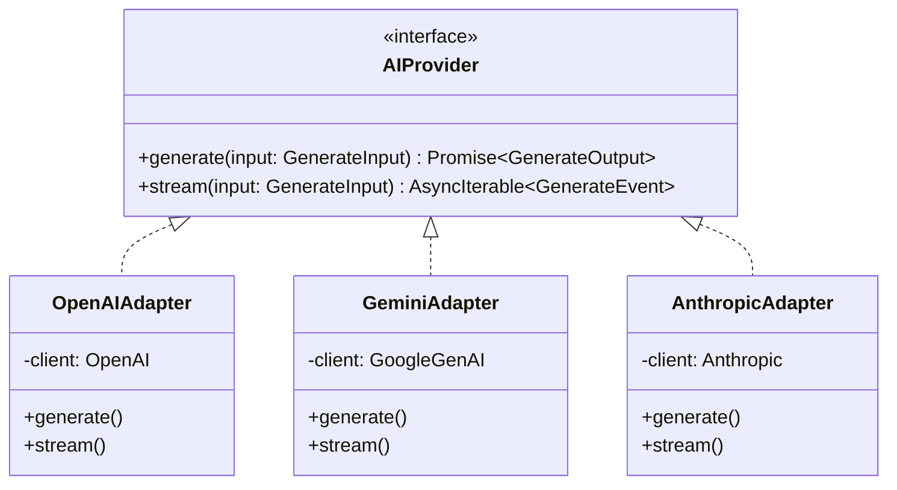
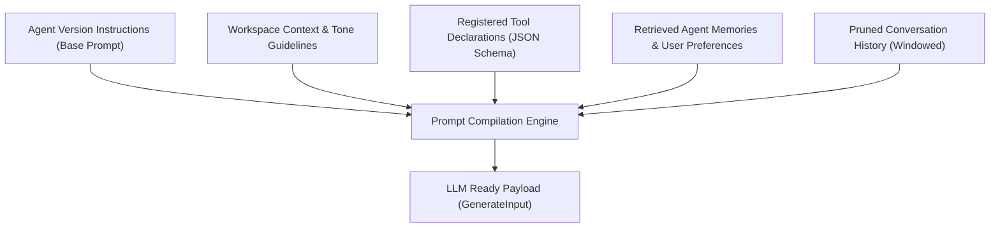
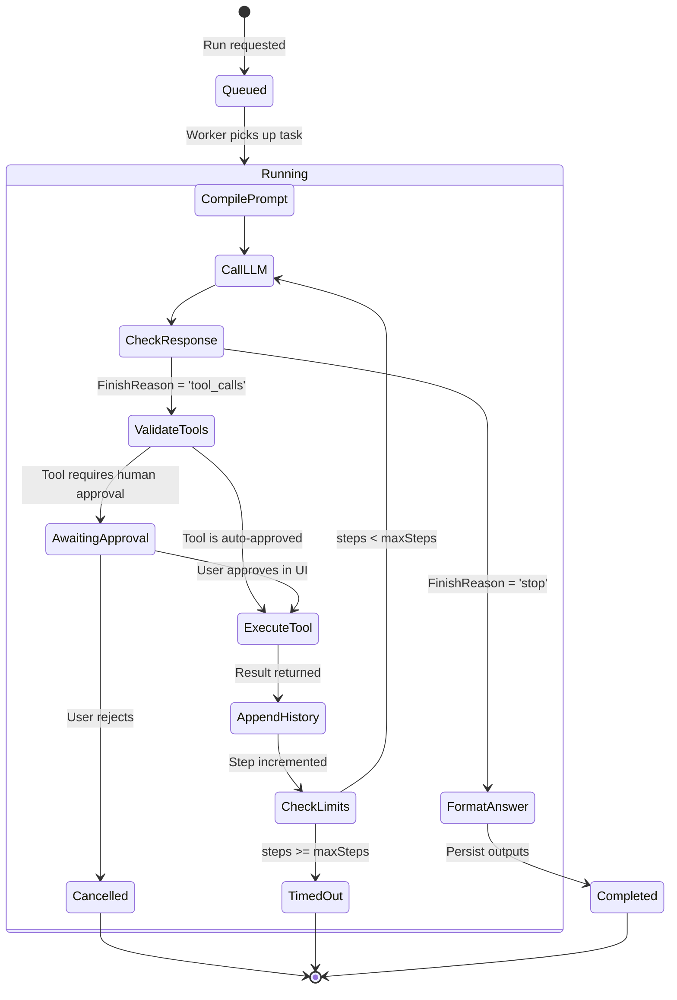

# 02 — Agent Runtime & Execution Engine Architecture

The Agent Runtime is the central brain of Meow. It orchestrates prompt compilation, model communication across heterogeneous LLM providers, multi-turn reasoning loops, tool invocations, and context window management.

---

## 1. Provider-Agnostic Model Abstraction

The core runtime never references vendor-specific SDK classes (e.g. `OpenAI()`, `GoogleGenerativeAI()`) directly. Instead, all providers implement a unified, strongly-typed contract.



### Core Interface Contract

```typescript
export type ChatRole = "system" | "user" | "assistant" | "tool";

export interface ChatMessage {
  role: ChatRole;
  content: string;
  name?: string;
  toolCallId?: string;
  toolCalls?: Array<{
    id: string;
    name: string;
    arguments: Record<string, unknown>;
  }>;
}

export interface ToolDefinitionSchema {
  name: string;
  description: string;
  parameters: Record<string, unknown>; // JSON Schema standard
}

export interface GenerateInput {
  model: string;
  messages: ChatMessage[];
  tools?: ToolDefinitionSchema[];
  temperature?: number;
  maxTokens?: number;
  stopSequences?: string[];
}

export interface GenerateOutput {
  content: string;
  toolCalls?: Array<{
    id: string;
    name: string;
    arguments: Record<string, unknown>;
  }>;
  finishReason: "stop" | "tool_calls" | "length" | "content_filter";
  usage: {
    promptTokens: number;
    completionTokens: number;
    totalTokens: number;
  };
}

export type GenerateEvent =
  | { type: "text_delta"; text: string }
  | { type: "tool_call_start"; id: string; name: string }
  | { type: "tool_call_delta"; id: string; argumentChunk: string }
  | { type: "tool_call_finish"; id: string; name: string; arguments: Record<string, unknown> }
  | { type: "finish"; reason: string; usage: GenerateOutput["usage"] };

export interface AIProvider {
  generate(input: GenerateInput): Promise<GenerateOutput>;
  stream(input: GenerateInput): AsyncIterable<GenerateEvent>;
}
```

---

## 2. Prompt Compilation Pipeline

Before reaching an LLM, a prompt is dynamically constructed by compiling multiple orthogonal layers:



### Compilation Layers:
1. **Base System Prompt:** Loaded from the immutable `agent_versions.instructions` record.
2. **Workspace Tenancy Wrapper:** Injects organization-level rules (e.g., security policies, preferred formatting, language requirements).
3. **Tool Declarations:** Converts enabled tools for that agent into standard JSON Schema function signatures accepted by the provider.
4. **Memory Injection:** Retrieves semantic long-term preferences from `agent_memories` (e.g., *"User prefers TypeScript over JavaScript"*).
5. **Context Window Token Budgeting:** Tokenizes prior conversation messages using model-specific tokenizers, truncating older messages while preserving system prompts and the latest turns.

---

## 3. The Autonomous Multi-Step Execution Loop

When a user submits a prompt or a routine triggers an autonomous run, the runtime executes a cycle of reasoning, tool calls, and validation until the task completes.



### Detailed Loop Logic in Pseudocode:
```typescript
async function executeAgentLoop(runContext: RunContext) {
  let step = 0;
  const maxSteps = runContext.agentConfig.maxSteps || 10;
  let messages = [...runContext.initialMessages];

  while (step < maxSteps) {
    step++;

    // 1. Compile prompt & invoke provider
    const compiledInput = compilePrompt(runContext, messages);
    const output = await runContext.aiProvider.generate(compiledInput);

    // 2. Append assistant response turn
    messages.push({
      role: "assistant",
      content: output.content,
      toolCalls: output.toolCalls,
    });

    // 3. Check termination: Model produced final answer
    if (!output.toolCalls || output.toolCalls.length === 0) {
      await finalizeRun(runContext.runId, "completed", output.content);
      return output.content;
    }

    // 4. Process each tool call requested by model
    for (const call of output.toolCalls) {
      // Step 4a: Validate schema
      const toolDef = await toolRegistry.get(call.name);
      const validatedArgs = toolDef.schema.parse(call.arguments);

      // Step 4b: Check permission & approval gates
      if (toolDef.requiresApproval) {
        await updateRunStatus(runContext.runId, "waiting_for_approval", call);
        const approval = await waitForUserApproval(runContext.runId, call.id);
        if (!approval.approved) {
          messages.push({ role: "tool", toolCallId: call.id, content: "Tool call rejected by user." });
          continue;
        }
      }

      // Step 4c: Execute tool in Target (Cloud Sandbox or Local Runner)
      const toolResult = await executeToolInTarget(runContext, toolDef, validatedArgs);

      // Step 4d: Append tool result turn
      messages.push({
        role: "tool",
        toolCallId: call.id,
        content: JSON.stringify(toolResult),
      });

      // Record telemetry in database
      await recordStep(runContext.runId, step, call, toolResult);
    }
  }

  // Safety threshold reached
  await finalizeRun(runContext.runId, "timed_out", "Maximum autonomous steps reached.");
}
```

---

## 4. Context Window & Token Budget Management

LLMs have hard context limits (e.g. 128k tokens for `gpt-4o`, 1M tokens for `gemini-1.5-pro`). Without proactive budget allocation, conversation histories can overflow or incur runaway costs.

### Token Allocation Strategy:
| Segment | Budget % | Strategy |
|---|:---:|---|
| **System & Tool Schemas** | 20% | Fixed priority. Never truncated. |
| **Retrieved Memory & Context** | 15% | Top-K relevance pruned via similarity scoring. |
| **Conversation History** | 45% | Sliding window: keep initial goal message + last $N$ turns. |
| **Generation Buffer** | 20% | Reserved for model completion and tool arguments. |

### Sliding Window with Summary Fallback
When active message history exceeds the 45% budget:
1. The oldest conversational turns (excluding the initial user intent) are summarized using a lightweight model (`gemini-2.0-flash` or `gpt-4o-mini`).
2. The raw turns are replaced with a single `system` turn: `[Prior Context Summary: ...]`.
3. The latest 6 interaction turns are preserved verbatim.

