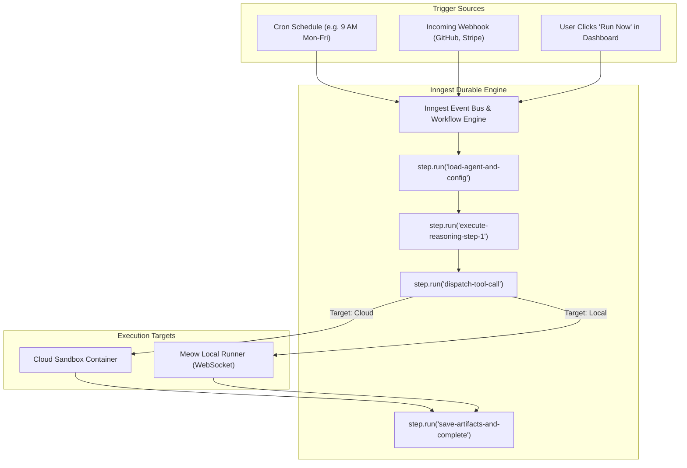
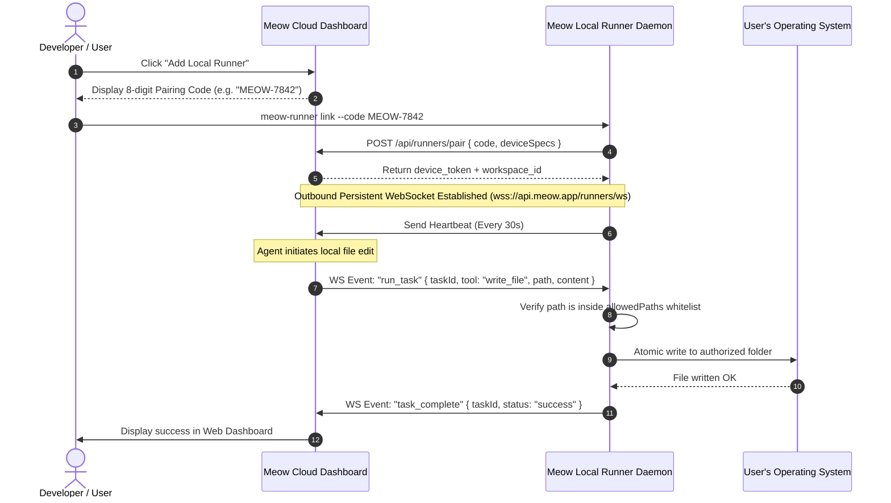
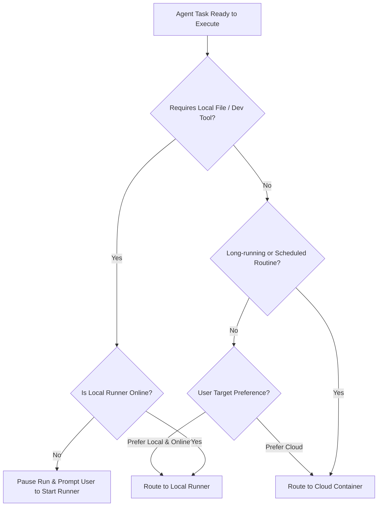

# 04 — Automation & Local/Cloud Runner Architecture

Meow supports both scalable cloud automation and local workstation execution. This document details the durable background orchestration powered by Inngest, the Meow Runner local daemon, and intelligent target routing.

---

## 1. Automation & Background Orchestration (Inngest)

Autonomous agent runs and scheduled routines cannot run within standard Next.js HTTP request-response cycles due to serverless timeouts and connection drops. Meow leverages **Inngest** for durable execution.



### Why Inngest?
1. **Durable Steps (`step.run`):** If a network timeout occurs during step 3, Inngest does not restart the entire 15-minute workflow. It resumes exactly from the failed step with cached outputs from steps 1 and 2.
2. **Idempotency Keys:** Every run is assigned an `idempotencyKey: "routine_${routineId}_${timestamp}"`. If an external webhook sends duplicate POST requests, Inngest deduplicates them automatically.
3. **Automatic Exponential Retries:** Transient API rate limits (e.g. LLM 429 errors) are retried with jitter without writing complex retry loops in business logic.

---

## 2. Cloud Execution vs. Local Workstation Execution

Meow classifies tasks into two execution domains:

| Dimension | Cloud Execution | Local Execution (Meow Runner) |
|---|---|---|
| **Where it runs** | Managed cloud micro-VM / headless container | The user's personal desktop or server |
| **Availability** | Always-on, 24/7 background availability | Only when user's machine is awake & connected |
| **Use cases** | Web scraping, scheduled competitor reports, API integrations | Editing local files, compiling Git repos, running local Bash scripts, interacting with desktop apps |
| **Filesystem access** | Ephemeral cloud workspace directory | Explicitly authorized host folders (e.g. `~/Projects/Meow`) |
| **Network profile** | Clean data-center IP / Cloud proxy | User's residential/corporate network (can access internal intranets) |

---

## 3. Meow Runner — Local Execution Daemon

The Meow Runner is a lightweight open-source daemon (written in Node.js / Rust) that runs on macOS, Windows, or Linux.



### Critical Security Invariants for Meow Runner:
1. **Outbound Connections Only:** The runner initiates an outbound TLS WebSocket connection to Meow Cloud. It **never opens inbound listening ports**, eliminating firewall and router configuration issues.
2. **Path Whitelisting:** The runner configuration file (`runner.config.json`) defines strict allowed directories:
   ```json
   {
     "allowedDirectories": [
       "C:\\Users\\manis\\workspace\\project-a",
       "C:\\Users\\manis\\documents\\reports"
     ],
     "allowTerminalExecution": false,
     "maxFileSizeMb": 50
   }
   ```
   Any tool call attempting path traversal (e.g. `../../Windows/System32` or `/etc/passwd`) is blocked client-side by the runner before executing.
3. **Immediate Revocation:** If a laptop is lost, the user can click **Revoke Device** in the web dashboard. Meow Cloud terminates the WebSocket and invalidates the device token immediately.

---

## 4. Intelligent Execution Router

When an agent is configured with target `auto`, the execution router evaluates requirements before dispatching:



