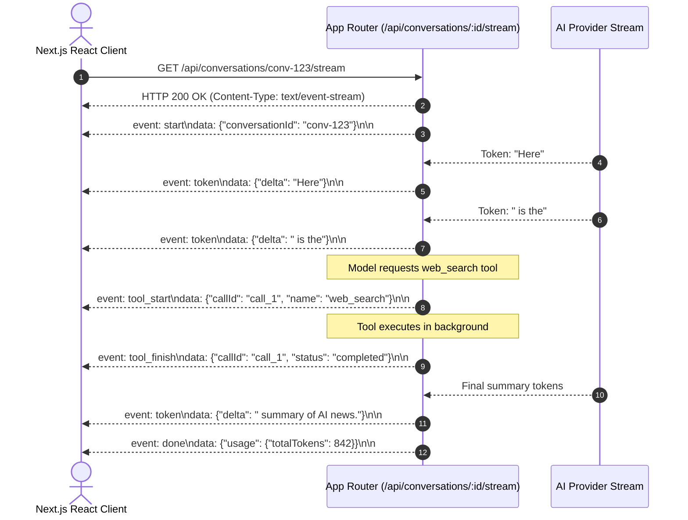

# 05 — API Specifications & Frontend Contracts

This document formalizes the HTTP REST interfaces, Server-Sent Events (SSE) real-time streaming protocol, and Next.js App Router component layout for **Meow**.

---

## 1. REST API Specification

### A. Workspaces & Identity
- `GET /api/workspaces`: List all workspaces where the authenticated user is an owner or member.
- `POST /api/workspaces`: Create a new team workspace (`{ name, slug }`).
- `GET /api/workspaces/:id`: Fetch workspace details and member list.
- `PATCH /api/workspaces/:id`: Update workspace settings (name, default policies).
- `POST /api/workspaces/:id/members`: Invite a member (`{ email, role: 'admin' | 'member' }`).

### B. Agents (Implemented & Extended)
- `GET /api/agents?workspaceId=:id`: List all agents in a workspace (status, model, latest version).
- `POST /api/agents`: Create a new agent and insert version 1 atomically.
- `GET /api/agents/:id`: Retrieve agent details, active version, and version history.
- `PATCH /api/agents/:id`: Update metadata or create a new immutable version (if instructions/model changed).
- `DELETE /api/agents/:id`: Soft delete / archive an agent.

### C. Conversations & Interactive Chat (Phase 3)
- `GET /api/conversations?workspaceId=:id&agentId=:id`: List conversations.
- `POST /api/conversations`: Start a conversation (`{ workspaceId, agentId, title }`).
- `GET /api/conversations/:id/messages`: Paginated message history.
- `POST /api/conversations/:id/messages`: Submit user message turn (`{ content, attachments }`).
- `GET /api/conversations/:id/stream`: SSE stream for assistant tokens and real-time tool calls.

### D. Autonomous Runs & Routines (Phase 6 & 7)
- `POST /api/runs`: Enqueue an asynchronous execution task (`{ agentId, input, target: 'auto' | 'cloud' | 'local' }`).
  - **Returns HTTP 202 Accepted:** `{ "runId": "run_abc123", "status": "queued" }`.
- `GET /api/runs/:id`: Get execution status, current step, and artifacts.
- `GET /api/runs/:id/events`: Real-time SSE stream of run telemetry.
- `POST /api/runs/:id/cancel`: Terminate an in-flight run.
- `POST /api/runs/:id/approve`: Approve a held dangerous tool call (`{ callId, approved: true }`).
- `GET /api/routines?workspaceId=:id`: List automated routines.
- `POST /api/routines`: Create an automation schedule or trigger.
- `POST /api/routines/:id/trigger`: Manually fire a routine out-of-schedule.

---

## 2. Real-Time Streaming Specification (Server-Sent Events)

Rather than polling, interactive chat and run dashboards stream data over an HTTP connection using Server-Sent Events (`text/event-stream`).



### Event Payload Schema:
```typescript
export type SSEEvent =
  | { event: "start"; data: { conversationId: string; messageId: string } }
  | { event: "token"; data: { delta: string } }
  | { event: "tool_start"; data: { callId: string; name: string; arguments: Record<string, unknown> } }
  | { event: "tool_finish"; data: { callId: string; result: unknown; status: string } }
  | { event: "approval_required"; data: { callId: string; tool: string; description: string } }
  | { event: "error"; data: { message: string; code: string } }
  | { event: "done"; data: { usage: { promptTokens: number; completionTokens: number; totalTokens: number } } };
```

---

## 3. Frontend Dashboard Architecture (Next.js App Router)

The user interface follows a modern modular sidebar + canvas layout.

```
app/
├── (auth)/
│   ├── sign-in/page.tsx
│   └── sign-up/page.tsx
│
├── (dashboard)/
│   ├── layout.tsx                   <- Workspace Context & Global Sidebar
│   ├── page.tsx                     <- Overview & Recent Activity
│   │
│   ├── agents/
│   │   ├── page.tsx                 <- Agent Gallery & Templates
│   │   ├── new/page.tsx             <- Agent Wizard
│   │   └── [id]/
│   │       ├── page.tsx             <- Agent Detail & History
│   │       ├── edit/page.tsx        <- Prompt & Model Builder Canvas
│   │       └── chat/page.tsx        <- Interactive Agent Chat Canvas
│   │
│   ├── automations/
│   │   ├── page.tsx                 <- Routines & Scheduled Tasks
│   │   └── runs/[id]/page.tsx       <- Real-Time Execution Inspector
│   │
│   ├── tools/
│   │   ├── page.tsx                 <- Tool Catalog & Permissions
│   │   └── integrations/page.tsx    <- Connected Third-Party Accounts
│   │
│   ├── execution/
│   │   ├── cloud/page.tsx           <- Cloud Sandbox Status
│   │   └── runners/page.tsx         <- Local Meow Runner Devices
│   │
│   └── settings/
│       ├── workspace/page.tsx       <- Tenancy & Members RBAC
│       └── billing/page.tsx         <- Usage, Tokens & Subscription
```

### Visual Layout Blueprint

```
+-----------------------------------------------------------------------------------+
|  [Meow Logo]   [Acme Corp Workspace v]                    [User Avatar: Alice]    |
+--------------+--------------------------------------------------------------------+
|  SIDEBAR     |  MAIN CANVAS AREA                                                  |
|              |                                                                    |
|  * Overview  |  +--------------------------------------------------------------+  |
|  * Agents    |  | Agent: Research Assistant (v2) - [Active]                     |  |
|  * Chat      |  +--------------------------------------------------------------+  |
|  * Routines  |  | [User]: Compare the performance of Gemini Flash and Claude.  |  |
|  * Runs      |  |                                                              |  |
|  * Tools     |  | [Agent]: Fetching benchmark datasets...                      |  |
|  * Devices   |  |   > [TOOL CALL: web_search] -> Success (4 sources found)     |  |
|  * Settings  |  |                                                              |  |
|              |  | Here is the comparative analysis based on recent benchmarks: |  |
|              |  | 1. Latency: Gemini 2.0 Flash averages 180ms TTFT...          |  |
|              |  +--------------------------------------------------------------+  |
|              |  | [ Type a prompt or task...                       ] [ Send ^ ] |  |
+--------------+--------------------------------------------------------------------+
```

